# BÁO CÁO KỸ THUẬT (TECHNICAL SPECIFICATIONS)

## Hệ thống quản lý dạy và học trực tuyến EducMind (SmartEdu)

| | |
|---|---|
| **Tên hệ thống** | EducMind — Hệ thống quản lý dạy và học số phổ thông |
| **Mã nguồn** | Repository `SmartEdu` |
| **Loại tài liệu** | Báo cáo kỹ thuật / Đặc tả hệ thống (Technical Specifications) |
| **Phiên bản** | 1.0.0 |
| **Ngày lập** | 27/11/2026 |

---

## MỤC LỤC

1. [Giới thiệu](#1-giới-thiệu)
2. [Đối tượng sử dụng](#2-đối-tượng-sử-dụng)
3. [Phân tích yêu cầu](#3-phân-tích-yêu-cầu)
4. [Kiến trúc hệ thống](#4-kiến-trúc-hệ-thống)
5. [Công nghệ và môi trường phát triển](#5-công-nghệ-và-môi-trường-phát-triển)
6. [Cơ sở dữ liệu](#6-cơ-sở-dữ-liệu)
7. [Các chức năng hệ thống](#7-các-chức-năng-hệ-thống)
8. [Luồng hoạt động các chức năng](#8-luồng-hoạt-động-các-chức-năng)
9. [Biểu đồ tuần tự](#9-biểu-đồ-tuần-tự-sequence-diagram)
10. [Quy định nghiệp vụ](#10-quy-định-nghiệp-vụ)
11. [Bảo mật hệ thống](#11-bảo-mật-hệ-thống)
12. [Kiểm thử hệ thống](#12-kiểm-thử-hệ-thống)
13. [Triển khai và vận hành](#13-triển-khai-và-vận-hành)
14. [Hạn chế và hướng phát triển](#14-hạn-chế-và-hướng-phát-triển)
15. [Phụ lục](#15-phụ-lục)

---

## 1. GIỚI THIỆU

### 1.1. Mục tiêu hệ thống

**EducMind** là hệ thống quản lý dạy và học trực tuyến (Learning Management System — LMS) phục vụ bậc phổ thông (khối lớp 3–12). Hệ thống hỗ trợ toàn bộ vòng đời dạy học số:

- **Quản lý lớp học**: tạo lớp, cấp mã lớp, quản lý thành viên.
- **Quản lý nội dung**: tổ chức nội dung theo cấu trúc **Chủ đề → Bài học → Mục tiêu học tập → Tài liệu**.
- **Ngân hàng câu hỏi**: 7 dạng câu hỏi theo độ khó và thang Bloom, nhập/xuất Excel.
- **Bài tập**: giao bài, rubric chấm theo tiêu chí, nộp tệp/văn bản, chấm điểm.
- **Bài kiểm tra**: làm bài tính giờ, tự động chấm, chấm tay, nhiều lượt làm.
- **Phân tích học tập (Learning Analytics)**: mức độ nắm vững (mastery), lỗ hổng kiến thức, gợi ý học tập, báo cáo tiến bộ.
- **Luyện tập thích ứng (Adaptive Practice)**: thuật toán bậc thang theo độ khó.
- **Trò chơi ôn tập**: 3 chế độ chơi bằng câu hỏi của lớp.
- **Trợ lý AI (Gemini)**: tạo câu hỏi nháp, trò chuyện hỗ trợ học tập.
- **Thông báo thời gian thực (Realtime)** và lịch/việc cần làm tự động.

### 1.2. Phạm vi

- Hệ thống phục vụ **một trường học / một giáo viên nhiều lớp** (mô hình đa lớp, mỗi lớp gắn một môn học).
- Người dùng truy cập qua **trình duyệt web** (không cần cài đặt ứng dụng).
- Dữ liệu lưu trữ trên đám mây (Firebase), không lưu dữ liệu nghiệp vụ trên máy người dùng.
- Giao diện tiếng Việt, hỗ trợ chế độ sáng/tối, responsive cho máy tính và thiết bị di động.

### 1.3. Thuật ngữ

| Thuật ngữ | Ý nghĩa |
|---|---|
| Lớp học (Class) | Đơn vị tổ chức học sinh của một giáo viên, có mã lớp 8 ký tự |
| Khóa học (Course) | Môn học gắn với một lớp (`courses.title` = tên môn học) |
| Chủ đề (Topic) | Đơn vị nội dung cấp 1 trong khóa học |
| Bài học (Lesson) | Đơn vị nội dung cấp 2, thuộc một chủ đề |
| Mục tiêu học tập (Learning Objective) | Kiến thức/kỹ năng cần đạt của bài học, có mã (code) |
| Tài liệu (Resource) | Tệp đính kèm hoặc liên kết gắn với bài học |
| Ngân hàng câu hỏi (Question Bank) | Kho câu hỏi của khóa học, gắn mục tiêu, độ khó, cấp Bloom |
| Bài tập (Assignment) | Giao việc cho học sinh, có hạn nộp, rubric chấm |
| Bài kiểm tra (Assessment) | Đề thi tính giờ, cửa sổ mở/đóng, nhiều lượt làm |
| Lượt làm (Attempt) | Một lần học sinh làm bài kiểm tra |
| Bằng chứng học tập (Evidence) | Kết quả làm bài được dùng để tính mức nắm vững |
| Mức nắm vững (Mastery) | Điểm 0–1 thể hiện mức độ đạt mục tiêu của học sinh |
| Lỗ hổng kiến thức (Knowledge Gap) | Mục tiêu học sinh chưa đạt, cần ôn tập |
| Luyện tập thích ứng (Adaptive Practice) | Luyện theo bậc thang độ khó, chấm ở máy chủ |

---

## 2. ĐỐI TƯỢNG SỬ DỤNG

Hệ thống có **2 đối tượng người dùng chính** phân biệt bằng vai trò (`profiles.role`), được xác định lúc đăng ký và **không thay đổi được sau khi tạo tài khoản**.

### 2.1. Giáo viên (TEACHER)

| Hạng mục | Mô tả |
|---|---|
| **Vai trò** | Chủ lớp, người soạn nội dung, ra đề, chấm bài, theo dõi tiến độ |
| **Đăng ký** | Tự đăng ký bằng email; khi đăng ký có thể nhập tên lớp + môn học ngay, hoặc bổ sung sau trong mục Tài khoản. Giáo viên **phải hoàn tất tên lớp và môn học** trước khi dùng chức năng dạy học (hệ thống nhắc nếu còn thiếu) |
| **Quyền** | Toàn quyền trên lớp của mình: tạo/sửa/xóa nội dung, bài tập, bài kiểm tra, câu hỏi; thêm/gỡ/chuyển học sinh; chấm điểm; xem báo cáo toàn lớp; quản lý API key Gemini; bật/tắt AI cho học sinh theo từng bài |
| **Giới hạn** | Chỉ thao tác trên lớp mình sở hữu (`owner_teacher_id == uid`); không đọc được dữ liệu lớp của giáo viên khác |

### 2.2. Học sinh (STUDENT)

| Hạng mục | Mô tả |
|---|---|
| **Vai trò** | Người học, làm bài tập, làm bài kiểm tra, ôn tập, chơi trò chơi |
| **Đăng ký** | Tự đăng ký bằng email rồi vào lớp bằng **mã lớp 8 ký tự**; hoặc giáo viên **tự tạo tài khoản cho học sinh** ngay trong trang lớp học (tự đặt mật khẩu giao cho học sinh) |
| **Quyền** | Xem bài học/tài liệu đã xuất bản của lớp mình; nộp bài tập; làm bài kiểm tra; luyện tập thích ứng; chơi trò chơi; xem tiến độ, điểm, nhận xét của bản thân; dùng Trợ lý AI (theo công tắc của giáo viên) |
| **Giới hạn** | Chỉ thuộc **một lớp cho mỗi giáo viên (mỗi môn học)**; **không tự chuyển lớp** — giáo viên là người thêm/gỡ/chuyển lớp; không xem được điểm/bài của học sinh khác; không tự chấm bài; bị khóa Trợ lý AI trong lúc đang làm bài |

### 2.3. Hệ thống (System / Máy chủ)

| Hạng mục | Mô tả |
|---|---|
| **Vai trò** | Tự động hóa: tính mức nắm vững, phát hiện lỗ hổng, sinh gợi ý học tập, gửi thông báo, xử lý AI, chấm luyện tập thích ứng |
| **Quyền** | Ghi các bảng phân tích (`mastery`, `learning_evidence`, `knowledge_gaps`, `recommendations`, `notifications`, `content_revisions`) — người dùng chỉ được đọc |
| **Cơ chế** | Máy chủ Express (`server.js`) xác thực Firebase ID token, gọi Gemini, mã hóa API key, cung cấp giờ máy chủ (`/api/server-now`) |

### 2.4. Sơ đồ phân quyền tổng quan

```
                    ┌─────────────────────────────┐
                    │         EducMind            │
                    └──────────────┬──────────────┘
                                   │
        ┌──────────────────────────┼──────────────────────────┐
        ▼                          ▼                          ▼
   GIÁO VIÊN                  HỌC SINH                   HỆ THỐNG
   (TEACHER)                  (STUDENT)              (Máy chủ + AI)
        │                          │                          │
  - Tạo lớp, cấp mã lớp      - Vào lớp bằng mã lớp     - Tính mastery
  - Soạn nội dung            - Học bài, xem tài liệu  - Phát hiện lỗ hổng
  - Ra bài tập/kiểm tra      - Nộp bài tập             - Sinh gợi ý học tập
  - Chấm điểm, rubric        - Làm bài kiểm tra        - Gửi thông báo
  - Quản lý học sinh         - Luyện tập thích ứng     - Tạo câu hỏi AI
  - Xem báo cáo lớp          - Chơi trò chơi           - Chấm luyện tập
  - Quản lý API key AI       - Hỏi Trợ lý AI           - Mã hóa API key
  - Bật/tắt AI theo bài      - Xem tiến độ của mình
```

---

## 3. PHÂN TÍCH YÊU CẦU

### 3.1. Yêu cầu chức năng (Functional Requirements)

| Mã | Yêu cầu | Đối tượng |
|---|---|---|
| FR-01 | Đăng ký tài khoản bằng email, xác nhận email bằng mã OTP, đăng nhập/đăng xuất, đặt lại mật khẩu | Giáo viên, Học sinh |
| FR-02 | Tạo lớp học, sinh mã lớp 8 ký tự, tạo khóa học/môn học gắn với lớp | Giáo viên |
| FR-03 | Thêm học sinh vào lớp bằng email, bằng mã lớp, hoặc tự tạo tài khoản học sinh; gỡ/chuyển lớp cho học sinh; lưu trữ/khôi phục lớp | Giáo viên |
| FR-04 | Vào lớp bằng mã lớp 8 ký tự | Học sinh |
| FR-05 | Soạn nội dung theo cấu trúc Chủ đề → Bài học → Mục tiêu học tập; xuất bản/đưa về nháp | Giáo viên |
| FR-06 | Tải tệp tài nguyên (mọi định dạng, ≤ 50 MB) và thêm liên kết vào bài học; xem trước tệp trong trình duyệt | Giáo viên |
| FR-07 | Xem bài học, mục tiêu và tài liệu đã xuất bản của lớp | Học sinh |
| FR-08 | Quản lý ngân hàng câu hỏi: tạo/sửa/xóa 7 dạng câu hỏi theo độ khó, cấp Bloom, khối lớp, gắn mục tiêu | Giáo viên |
| FR-09 | Nhập/xuất ngân hàng câu hỏi bằng Excel/Word/CSV | Giáo viên |
| FR-10 | Ra bài tập: hạn nộp, nộp muộn, rubric nhiều tiêu chí, đối tượng giao, gắn câu hỏi (tạo mới/chọn từ ngân hàng/nhập tệp) | Giáo viên |
| FR-11 | Nộp/nộp lại bài tập bằng tệp đính kèm hoặc văn bản; xem điểm, nhận xét, rubric | Học sinh |
| FR-12 | Chấm bài tập theo rubric từng tiêu chí hoặc chấm tổng; xem trước tệp bài nộp khi chấm; cấp lượt làm bù | Giáo viên |
| FR-13 | Ra bài kiểm tra: chọn câu từ ngân hàng, trọng số điểm từng câu, cửa sổ mở/đóng, thời gian làm, số lượt làm | Giáo viên |
| FR-14 | Làm bài kiểm tra tính giờ: tự lưu, tự nộp khi hết giờ, F5 không mất bài, làm nhiều lượt (kể cả lượt bù) | Học sinh |
| FR-15 | Chấm tự động câu khách quan, chấm tay câu tự luận/trả lời ngắn, tự cộng điểm theo trọng số | Hệ thống, Giáo viên |
| FR-16 | Luyện tập thích ứng theo bậc thang độ khó, chấm ở máy chủ, giới hạn phiên tính điểm mỗi ngày | Học sinh, Hệ thống |
| FR-17 | Chơi trò chơi ôn tập 3 chế độ (Nhanh, Đua tốc độ, Sinh tồn) bằng câu hỏi của lớp | Học sinh |
| FR-18 | Tính mức nắm vững, phát hiện lỗ hổng kiến thức, sinh gợi ý học tập từ bằng chứng học tập | Hệ thống |
| FR-19 | Xem mức nắm vững, lỗ hổng, gợi ý học tập, chất lượng lớp học | Giáo viên |
| FR-20 | Xem tiến độ, mức nắm vững, lỗ hổng, đề xuất luyện tập của bản thân | Học sinh |
| FR-21 | Báo cáo tiến bộ (tổng hợp/chi tiết), xuất Excel (kèm sheet Bảng điểm), Word, in báo cáo | Giáo viên, Học sinh |
| FR-22 | AI tạo câu hỏi nháp bằng Gemini (≤ 20 câu/lượt), theo dõi tiến độ nền, duyệt/sửa-và-duyệt/từ chối | Giáo viên |
| FR-23 | Trợ lý AI trò chuyện hỗ trợ học tập; khóa AI khi học sinh đang làm bài; công tắc AI theo từng bài | Giáo viên, Học sinh |
| FR-24 | Quản lý API key Gemini (BYO key): lưu, kiểm tra, xóa; mã hóa AES-256-GCM | Giáo viên, Học sinh |
| FR-25 | Thông báo thời gian thực (Realtime), tự fallback polling 10 giây | Giáo viên, Học sinh |
| FR-26 | Lịch & việc cần làm tự động theo hạn nộp và trạng thái chấm | Giáo viên, Học sinh |
| FR-27 | Thùng rác: xóa mềm, khôi phục, xóa vĩnh viễn; xem lịch sử chỉnh sửa nội dung | Giáo viên |
| FR-28 | Xem lịch sử chơi trò chơi của lớp | Giáo viên |

### 3.2. Yêu cầu phi chức năng (Non-Functional Requirements)

| Mã | Yêu cầu | Mô tả |
|---|---|---|
| NFR-01 | **Bảo mật** | Phân quyền ở tầng cơ sở dữ liệu (Firestore Security Rules); mã hóa API key AES-256-GCM; chống XSS; CSP chặt; xác thực Firebase ID token ở máy chủ |
| NFR-02 | **Hiệu năng** | Trang tải nhanh (tệp tĩnh, thư viện đóng gói sẵn, không CDN); Realtime thông báo; polling fallback 10 giây |
| NFR-03 | **Khả dụng** | Giờ máy chủ thống nhất cho hạn nộp/đồng hồ thi; tự lưu bài làm dở; khôi phục phiên F5; cache nháp offline |
| NFR-04 | **Khả mở rộng** | Kiến trúc không framework, mô-đun hóa theo tệp số; cấu hình khối lớp và ngưỡng luyện tập thay đổi được qua cấu hình |
| NFR-05 | **Khả dùng** | Giao diện tiếng Việt; chế độ sáng/tối; responsive máy tính + di động; thanh tiến trình tải tệp; xem trước tệp ngay trong trình duyệt |
| NFR-06 | **Khả kiểm thử** | 44 unit test tự động + kiểm thử Security Rules; kiểm tra cú pháp toàn bộ JS |
| NFR-07 | **Khả triển khai** | Chạy bằng `npm start` (Node.js ≥ 20.12) hoặc máy chủ tệp tĩnh; backend Firebase miễn phí là đủ |

### 3.3. Sơ đồ Use Case — Giáo viên

```mermaid
flowchart LR
    Teacher["Giáo viên"]
    subgraph EducMind["EducMind"]
        UC1(("Đăng ký / Đăng nhập / Xác nhận email"))
        UC2(("Tạo lớp, sinh mã lớp"))
        UC3(("Quản lý học sinh (thêm/gỡ/chuyển)"))
        UC4(("Soạn nội dung (Chủ đề → Bài học → Mục tiêu)"))
        UC5(("Tải tệp tài nguyên & liên kết"))
        UC6(("Quản lý ngân hàng câu hỏi (7 dạng)"))
        UC7(("Nhập/xuất câu hỏi Excel/Word/CSV"))
        UC8(("Ra bài tập + rubric"))
        UC9(("Chấm bài tập theo tiêu chí"))
        UC10(("Ra bài kiểm tra (cửa sổ, lượt làm)"))
        UC11(("Chấm tay câu tự luận / Chấm lại"))
        UC12(("AI tạo câu hỏi nháp & duyệt"))
        UC13(("Trợ lý AI (chat)"))
        UC14(("Quản lý API key Gemini"))
        UC15(("Xem mức nắm vững / Lỗ hổng / Gợi ý"))
        UC16(("Báo cáo tiến bộ, xuất Excel/Word/in"))
        UC17(("Lịch & việc cần làm"))
        UC18(("Thùng rác & khôi phục"))
        UC19(("Xem lịch sử chỉnh sửa"))
        UC20(("Xem lịch sử chơi của lớp"))
        UC21(("Bật/tắt AI cho học sinh theo bài"))
    end
    Teacher --> UC1
    Teacher --> UC2
    Teacher --> UC3
    Teacher --> UC4
    Teacher --> UC5
    Teacher --> UC6
    Teacher --> UC7
    Teacher --> UC8
    Teacher --> UC9
    Teacher --> UC10
    Teacher --> UC11
    Teacher --> UC12
    Teacher --> UC13
    Teacher --> UC14
    Teacher --> UC15
    Teacher --> UC16
    Teacher --> UC17
    Teacher --> UC18
    Teacher --> UC19
    Teacher --> UC20
    Teacher --> UC21
```

### 3.4. Sơ đồ Use Case — Học sinh

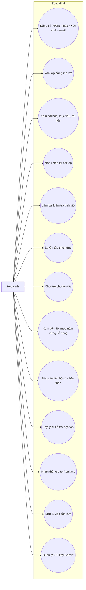

### 3.5. Sơ đồ Use Case tổng hợp (kèm quan hệ include/extend)

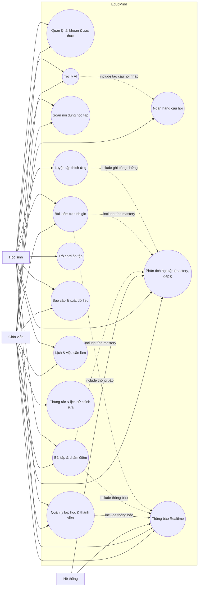

### 3.6. Bảng mô tả Use Case chi tiết (mẫu)

| Thuộc tính | UC-05: Nộp bài tập (Học sinh) |
|---|---|
| **Mã** | FR-11 |
| **Actor** | Học sinh |
| **Mô tả** | Học sinh nộp bài tập bằng tệp đính kèm và/hoặc văn bản, có thể nộp lại theo số lượt giáo viên đặt |
| **Điều kiện tiên quyết** | Đã đăng nhập; đã vào lớp; bài tập đã xuất bản; chưa quá hạn nộp (hoặc được cho nộp muộn) |
| **Luồng chính** | 1. Học sinh mở trang Bài tập, chọn bài. 2. Chọn tệp đính kèm và/hoặc nhập văn bản. 3. Hệ thống tải tệp lên Storage (thanh tiến trình). 4. Hệ thống ghi `assignment_submissions` với trạng thái SUBMITTED/LATE. 5. Hệ thống gửi thông báo cho giáo viên. |
| **Luồng thay thế** | Nộp lại: ghi đè bài nộp chưa chấm. Bài đã chấm (GRADED): không cho sửa. |
| **Điều kiện sau** | Bài nộp ở trạng thái SUBMITTED/LATE, chờ giáo viên chấm |
| **Quy tắc nghiệp vụ** | B3, B4, B7 (mục 10.5) |

| Thuộc tính | UC-06: Làm bài kiểm tra (Học sinh) |
|---|---|
| **Mã** | FR-14 |
| **Actor** | Học sinh |
| **Mô tả** | Học sinh làm bài kiểm tra tính giờ, tự lưu, tự nộp khi hết giờ, F5 không mất bài |
| **Điều kiện tiên quyết** | Đã đăng nhập; đã vào lớp; bài kiểm tra đã xuất bản; đang trong cửa sổ mở/đóng theo giờ máy chủ; còn lượt làm |
| **Luồng chính** | 1. Học sinh bắt đầu lượt làm → tạo `assessment_attempts` (IN_PROGRESS). 2. Trả lời từng câu → tự lưu `submission_answers`. 3. Nộp tay hoặc hết giờ tự nộp → trạng thái SUBMITTED. 4. Hệ thống chấm tự động câu khách quan, cộng điểm theo trọng số. 5. Câu tự luận chờ giáo viên chấm tay → GRADED. |
| **Luồng thay thế** | F5/mất mạng: khôi phục lượt làm dở. Hết lượt: giáo viên cấp lượt bù. |
| **Điều kiện sau** | Lượt làm ở trạng thái GRADED (khóa), học sinh xem điểm và giải thích |
| **Quy tắc nghiệp vụ** | K1–K8 (mục 10.6) |

| Thuộc tính | UC-11: Trợ lý AI (Học sinh) |
|---|---|
| **Mã** | FR-23 |
| **Actor** | Học sinh |
| **Mô tả** | Học sinh hỏi Trợ lý AI hỗ trợ học tập, bị khóa khi đang làm bài |
| **Điều kiện tiên quyết** | Đã đăng nhập; có API key (key riêng hoặc key giáo viên chủ lớp); giáo viên bật AI cho bài (nếu hỏi trong ngữ cảnh bài) |
| **Luồng chính** | 1. Học sinh mở khung chat, gửi tin nhắn. 2. Máy chủ kiểm tra key, trạng thái làm bài, công tắc AI. 3. Gọi Gemini với ngữ cảnh bài học (không gửi dữ liệu cá nhân). 4. Trả lời Markdown an toàn. |
| **Luồng thay thế** | Thiếu key → 400 MISSING_API_KEY. Đang làm bài → 423 AI_LOCKED_WHILE_WORKING. Giáo viên tắt AI → 403 AI_DISABLED_FOR_WORK. |
| **Điều kiện sau** | Hội thoại được lưu (`ai_chat_threads`, `ai_chat_messages`) |
| **Quy tắc nghiệp vụ** | A1–A9 (mục 10.8) |

---

## 4. KIẾN TRÚC HỆ THỐNG

### 4.1. Mô hình kiến trúc

Hệ thống theo mô hình **Client – Server 3 tầng**, trong đó:

- **Tầng trình bày (Client)**: Trang web tĩnh duy nhất `index.html`, nạp các tệp JS/CSS theo thứ tự số trong tên tệp. Không dùng framework, không cần bước build (build tùy chọn bằng esbuild).
- **Tầng dịch vụ (Backend)**: Firebase (Auth, Firestore, Storage) cho dữ liệu và xác thực; máy chủ **Express (Node.js)** cho các tác vụ nhạy cảm (AI Gemini, luyện tập thích ứng, giờ máy chủ).
- **Tầng dữ liệu**: Firestore (NoSQL dạng tài liệu) + Firebase Storage (tệp).

```
┌──────────────────────────────────────────────────────────────┐
│                    TRÌNH DUYỆT (Client)                       │
│  index.html (1 trang) + js/*.js + css/*.css (JavaScript thuần)│
│  - Giao diện, điều hướng, kiểm tra dữ liệu phía client        │
│  - Thư viện đóng gói sẵn: firebase-sdk, xlsx (SheetJS),       │
│    mammoth (đọc Word) — không phụ thuộc CDN                   │
└───────────────┬──────────────────────────────┬────────────────┘
                │ Firebase SDK                 │ REST /api/* (ID token)
                ▼                              ▼
┌───────────────────────────────┐   ┌──────────────────────────────┐
│         FIREBASE              │   │     MÁY CHỦ EXPRESS        │
│  - Auth (email + OTP xác thực)│   │     (server.js, Node.js)     │
│  - Firestore (47 collections) │   │  - /api/ai/generate (Gemini) │
│  - Storage (tài liệu, bài nộp)│   │  - /api/ai/chat             │
│  - Security Rules (firestore. │   │  - /api/ai/key (BYO key)    │
│    rules) — phân quyền ở DB   │   │  - /api/practice/*          │
│  - Realtime (onSnapshot)      │   │  - /api/server-now          │
└───────────────────────────────┘   └──────────────┬───────────────┘
                                                   │ HTTPS
                                                   ▼
                                        ┌────────────────────┐
                                        │  Google Gemini API │
                                        │  (AI tạo câu hỏi,  │
                                        │   trò chuyện)      │
                                        └────────────────────┘
```

### 4.2. Nguyên tắc thiết kế

1. **Phân quyền ở tầng cơ sở dữ liệu**: Mọi quyền đọc/ghi do **Firestore Security Rules** quyết định, không tin dữ liệu do trình duyệt gửi (ví dụ vai trò luôn lấy từ `profiles/{uid}.role`).
2. **Mọi lệnh dữ liệu qua một cửa ngõ**: `EducMindDB` trong `js/03-firebase.js` chứa ~162 hàm, mỗi hàm tương ứng một lệnh tới Firestore. Giao diện không gọi Firestore trực tiếp.
3. **AI chạy ở máy chủ**: Trình duyệt không bao giờ gọi Gemini trực tiếp; API key được mã hóa AES-256-GCM ở máy chủ.
4. **Giờ máy chủ**: Hạn nộp và đồng hồ làm bài tính theo giờ máy chủ (`/api/server-now`), không phụ thuộc đồng hồ máy người dùng.
5. **Xóa mềm (Soft Delete)**: Nội dung xóa vào Thùng rác (`deleted_at`), có thể khôi phục; chỉ xóa vĩnh viễn khi dọn Thùng rác.
6. **Offline-first một phần**: Bài làm dở được lưu nháp cục bộ (localStorage), đồng bộ khi có mạng; F5 không mất bài.

### 4.3. Cấu trúc mã nguồn

```
index.html                  Trang duy nhất, nạp toàn bộ CSS/JS theo thứ tự số
css/  (17 tệp)              Kiểu dáng; số càng lớn càng nạp sau (ghi đè)
js/
  00-grade-config.js        Dải khối lớp dùng chung (khối 3–12)
  02-state.js … 77-*        16 mô-đun giao diện dùng chung (trạng thái, biểu tượng,
                            tiện ích, khung trang, xác thực, hình đại diện,
                            đọc tệp Excel/Word/CSV, hiệu ứng kính)
  03-firebase.js            Kết nối Firebase + EducMindDB (~162 hàm dữ liệu)
  db/                       Màn hình dữ liệu thật (đăng nhập Firebase)
    01-core.js              Vào app, đăng xuất, phiên, đồng bộ chuông báo
    02-shell.js             Vỏ ứng dụng: điều hướng theo vai trò, thông báo
    03-classes.js           Lớp học, thành viên, mã lớp
    04-content.js           Chủ đề – Bài học – Mục tiêu
    04b-resources-trash.js  Tài liệu, Thùng rác
    05-assignments.js       Bài tập
    05b-assignment-grading.js Chấm bài tập theo rubric
    05c-assignment-student.js Học sinh nộp bài
    06-questions.js         Ngân hàng câu hỏi (7 dạng)
    07-assessments.js       Bài kiểm tra (ra đề)
    08-exam.js              Học sinh làm bài kiểm tra (đồng hồ)
    09-progress.js          Mức nắm vững, lỗ hổng, gợi ý
    10-home.js              Trang Tổng quan
    11-transfer.js          Nhập/xuất dữ liệu
    12-schedule.js          Lịch & việc cần làm
    13-report.js            Báo cáo tiến bộ, xuất Excel/Word/in
    14-ai.js                AI tạo câu hỏi nháp
    14b-ai-chat.js          Trợ lý AI (chat nổi + trang chat)
    14c-ai-key.js           Quản lý API key Gemini (BYO key)
    15-games.js             Trò chơi ôn tập 3 chế độ
    16-live.js              Realtime thông báo (fallback polling 10 giây)
    17-practice.js          Luyện tập thích ứng
    18-class-overview.js    Chất lượng lớp học
  vendor/                   Thư viện đóng gói sẵn (firebase-sdk, xlsx, mammoth)
server.js                   Máy chủ Express: AI, luyện tập, giờ máy chủ, phục vụ tĩnh
firestore.rules             Quy tắc bảo mật Firestore (phân quyền ở DB)
tests/                      Kiểm thử tự động (Node.js) + trang kiểm thử trình duyệt
supabase/                   (Di sản) Thiết kế backend PostgreSQL trước đây — xem §6.4
```

---

## 5. CÔNG NGHỆ VÀ MÔI TRƯỜNG PHÁT TRIỂN

### 5.1. Ngôn ngữ và nền tảng

| Hạng mục | Công nghệ |
|---|---|
| **Ngôn ngữ lập trình** | **JavaScript** (ES Modules phía máy chủ; JavaScript thuần phía trình duyệt) |
| **Frontend** | JavaScript thuần (Vanilla JS), HTML5, CSS3 — **không framework** (không React/Vue/Angular), **không cần bước build** |
| **Backend** | **Node.js** (≥ 20.12) + **Express 5** (`server.js`, ~84 KB mã nguồn) |
| **Cơ sở dữ liệu** | **Firebase Firestore** (NoSQL dạng tài liệu) |
| **Xác thực** | **Firebase Authentication** (email + mã OTP xác nhận email) |
| **Lưu trữ tệp** | **Firebase Storage** |
| **AI** | **Google Gemini API** qua thư viện `@google/genai` (mô hình `gemini-3.1-flash-lite` cho tác vụ nhanh, `gemini-4-hydrogen` cho tác vụ cân bằng/sâu) |
| **Đọc/ghi Excel** | **SheetJS (xlsx)** — đóng gói sẵn trong `js/vendor/` |
| **Đọc Word** | **Mammoth.js** — đóng gói sẵn trong `js/vendor/` |
| **Đóng gói (tùy chọn)** | **esbuild** (`scripts/build.mjs`, `scripts/bundle-firebase.mjs`) |
| **Kiểm thử** | **Node.js Test Runner** (`node:test`) + Firebase Rules Unit Testing |
| **Kiểm tra cú pháp** | `node --check` qua `npm run lint` |
| **Quản lý gói** | npm (Bun lockfile `bun.lock` đi kèm) |

### 5.2. Yêu cầu môi trường

| Môi trường | Yêu cầu |
|---|---|
| **Máy phát triển** | Node.js ≥ 20.12 (cho máy chủ + kiểm thử); trình duyệt hiện đại (Chrome/Edge/Firefox/Safari) |
| **Máy chủ triển khai** | Node.js ≥ 20.12; biến môi trường `AI_KEY_ENCRYPTION_KEY` (≥ 32 ký tự), tùy chọn `GEMINI_API_KEY`, `GEMINI_MODEL`, `PORT` (mặc định 3000) |
| **Firebase** | Dự án Firebase: Auth (bật xác nhận email), Firestore, Storage; áp dụng `firestore.rules` |
| **Mạng** | Máy chủ cần ra được Internet (gọi `googleapis.com`, `firestore.googleapis.com`); mọi lời gọi ra ngoài có timeout 15 giây và thử lại 1 lần |

### 5.3. Chạy hệ thống

```bash
# Cài đặt phụ thuộc
npm install

# Chạy máy chủ (phục vụ web + API AI) trên cổng 3000
npm start            # = node server.js

# Hoặc chỉ phục vụ tệp tĩnh (không có API AI) trên cổng 5500
python3 -m http.server 5500

# Kiểm thử tự động
npm test             # node --test tests/*.test.mjs

# Kiểm tra cú pháp toàn bộ JS
npm run lint
```

---

## 6. CƠ SỞ DỮ LIỆU

### 6.1. Lựa chọn cơ sở dữ liệu

Hệ thống sử dụng **Firebase Firestore** — cơ sở dữ liệu NoSQL dạng tài liệu (document-oriented), trong đó:

- Dữ liệu tổ chức thành **collections** (tập hợp) chứa **documents** (tài liệu), mỗi tài liệu là một map khóa–giá trị (JSON-like).
- Mỗi tài liệu có trường `id` trùng với ID tài liệu, `createdAt`/`updatedAt` do **máy chủ** ghi (`serverTimestamp()`), không tin thời gian do trình duyệt gửi.
- Phân quyền do **Firestore Security Rules** (`firestore.rules`, ~102 KB) đảm nhiệm: mỗi collection có quy tắc tạo/đọc/sửa/xóa riêng, kiểm tra vai trò, quyền sở hữu, trạng thái và giới hạn kích thước trường.
- Tệp (tài liệu bài học, bài nộp) lưu ở **Firebase Storage**, đường dẫn lưu trong tài liệu (`storage_path`).

### 6.2. Danh mục collections (47 collections)

| Nhóm | Collection | Nội dung |
|---|---|---|
| **Người dùng** | `profiles` | Hồ sơ người dùng: `id`, `email`, `full_name`, `role` (TEACHER/STUDENT) |
| | `email_index` | Chỉ mục email (hash) phục vụ tra cứu |
| **Lớp học** | `classes` | Lớp học: `name`, `grade`, `school_year`, `owner_teacher_id`, `deleted_at` |
| | `class_members` | Thành viên lớp: `class_id`, `student_id`, `teacher_id`, `joined_at` |
| | `class_invites` | Lời mời vào lớp: `class_id`, `teacher_id`, `code`, `expires_at`, `revoked_at` |
| | `class_invite_codes` | Mã lớp 8 ký tự để học sinh tự vào lớp |
| | `teacher_students` | Liên kết giáo viên–học sinh (mỗi học sinh 1 lớp/giáo viên) |
| | `student_teachers` | Liên kết học sinh–giáo viên (chiều ngược) |
| | `class_indexes` | Chỉ mục nội dung lớp phục vụ học sinh đọc |
| **Khóa học & nội dung** | `courses` | Khóa học/môn học: `class_id`, `teacher_id`, `title`, cấu hình luyện tập |
| | `course_topics` | Chủ đề: `course_id`, `title`, `status` (DRAFT/PUBLISHED) |
| | `lessons` | Bài học: `course_id`, `topic_id`, `title`, `status` |
| | `learning_objectives` | Mục tiêu học tập: `course_id`, `lesson_id`, `code`, `description` |
| | `resources` | Tài liệu: `kind` (file/link), `url`, `storage_path`, `file_size_bytes`, `mime_type` |
| | `resource_objective_links` | Liên kết tài liệu–mục tiêu |
| **Câu hỏi** | `questions` | Ngân hàng câu hỏi: `content`, `kind`, `options`, `correct_answer`, `difficulty`, `grade`, `bloom_level` |
| | `question_objectives` | Liên kết câu hỏi–mục tiêu |
| **Bài tập** | `assignments` | Bài tập: `title`, `due_at`, `allow_late`, `late_close_at`, `max_score`, `status`, `student_ai_enabled` |
| | `assignment_targets` | Đối tượng được giao (cả lớp / nhóm / cá nhân) |
| | `assignment_objectives` | Liên kết bài tập–mục tiêu |
| | `assignment_questions` | Câu hỏi gắn vào bài tập |
| | `assignment_submissions` | Bài nộp: `text_content`, `storage_path`, `status` (SUBMITTED/LATE/GRADED), `score`, `feedback` |
| | `assignment_submission_answers` | Trả lời từng câu trong bài tập |
| | `rubric_criteria` | Tiêu chí chấm: `title`, `max_score`, `display_order` |
| | `rubric_scores` | Điểm theo tiêu chí: `score`, `feedback` |
| **Bài kiểm tra** | `assessments` | Đề kiểm tra: `title`, `duration_minutes`, `max_attempts`, `open_at`, `close_at`, `status`, `student_ai_enabled` |
| | `assessment_questions` | Câu hỏi trong đề: `weight` (điểm), `display_order` |
| | `assessment_attempts` | Lượt làm: `attempt_number`, `status` (IN_PROGRESS/SUBMITTED/GRADED), `total_score` |
| | `assessment_extra_attempts` | Lượt làm bù do giáo viên cấp thêm |
| | `submission_answers` | Trả lời từng câu trong lượt làm: `answer_content`, `score`, `feedback` |
| **Phân tích học tập** | `mastery` | Mức nắm vững: `student_id`, `objective_id`, `mastery_score` (0–1), `evidence_count` |
| | `learning_evidence` | Bằng chứng học tập (chỉ máy chủ ghi) |
| | `mastery_snapshots` | Ảnh chụp mức nắm vững theo thời điểm |
| | `practice_sessions` | Phiên luyện tập thích ứng |
| | `practice_answers` | Trả lời trong phiên luyện tập |
| | `knowledge_gaps` | Lỗ hổng kiến thức: `status` (OPEN/RESOLVED/DISMISSED) |
| | `recommendations` | Gợi ý học tập: `kind`, `status` (ACTIVE/ACCEPTED/DISMISSED) |
| **Thông báo & lịch sử** | `notifications` | Thông báo: `user_id`, `type`, `title`, `content`, `is_read` |
| | `content_revisions` | Nhật ký chỉnh sửa nội dung (chỉ máy chủ ghi) |
| **AI** | `ai_generation_requests` | Yêu cầu tạo câu hỏi AI: `lesson_id`, `quantity`, `status` |
| | `ai_generation_outputs` | Câu hỏi nháp AI: `review_status` (PENDING_REVIEW/APPROVED/REJECTED/EDITED_AND_APPROVED) |
| | `ai_generation_jobs` | Công việc AI nền: `status`, `error_message` |
| | `ai_chat_threads` | Hội thoại AI (riêng tư từng người dùng) |
| | `ai_chat_messages` | Tin nhắn AI: `sender`, `model`, `content`, `artifacts` |
| | `ai_keys` | API key Gemini đã mã hóa: `ciphertext`, `iv`, `tag`, `key_hint` (4 ký tự cuối) |
| **Trò chơi** | `game_sessions` | Lịch sử chơi: `mode`, `source`, `question_count`, `correct_count`, `score`, `duration_seconds` |
| **Kiểm tra kết nối** | `test` | Tài liệu kiểm tra kết nối Firebase |

### 6.3. Mô hình dữ liệu (quan hệ giữa các thực thể)

```
profiles (người dùng)
   │ 1 ── N (owner_teacher_id)
   ▼
classes (lớp học) ── 1 ── 1 courses (khóa học/môn học)
   │                              │
   │ N ── N (class_members)       ├── 1 ── N course_topics (chủ đề)
   │                              │              │ 1 ── N
   │                              │              ▼
   │                              │         lessons (bài học)
   │                              │              │ 1 ── N
   │                              │              ▼
   │                              │         learning_objectives (mục tiêu)
   │                              │              ▲
   │                              ├── 1 ── N resources (tài liệu)
   │                              │
   │                              ├── 1 ── N questions (ngân hàng câu hỏi)
   │                              │              │ N ── N (question_objectives)
   │                              │
   │                              ├── 1 ── N assignments (bài tập)
   │                              │      ├── assignment_questions (câu hỏi trong bài)
   │                              │      ├── assignment_submissions (bài nộp)
   │                              │      │      └── assignment_submission_answers
   │                              │      └── rubric_criteria → rubric_scores
   │                              │
   │                              └── 1 ── N assessments (bài kiểm tra)
   │                                     ├── assessment_questions (câu + trọng số)
   │                                     ├── assessment_attempts (lượt làm)
   │                                     │      └── submission_answers (trả lời từng câu)
   │                                     └── assessment_extra_attempts (lượt bù)
   │
   └── Phân tích: mastery, learning_evidence, knowledge_gaps,
       recommendations, practice_sessions, game_sessions, notifications
```

**Đặc điểm mô hình:**

- Mọi thực thể nội dung đều mang `class_id` + `teacher_id` để phân quyền theo lớp.
- Quan hệ nhiều–nhiều (câu hỏi ↔ mục tiêu, bài tập ↔ câu hỏi, tài liệu ↔ mục tiêu) dùng **collection liên kết** riêng (ví dụ `question_objectives`, `assignment_questions`).
- Trạng thái xuất bản thống nhất: `DRAFT` (nháp) / `PUBLISHED` (đã xuất bản) cho chủ đề, bài học, bài tập, bài kiểm tra.
- Xóa mềm bằng `deleted_at`; Thùng rác có thể khôi phục hoặc xóa vĩnh viễn (purge).

### 6.4. Ghi chú về thiết kế Supabase (di sản)

Repository còn chứa thư mục `supabase/` (52 tệp migration SQL + 3 Edge Functions) — đây là **thiết kế backend PostgreSQL/Supabase trước đây** (bảng quan hệ, RLS, RPC, trigger tính mastery). **Bản triển khai hiện tại dùng Firebase/Firestore** (mã nguồn `js/03-firebase.js`, `firestore.rules`, `server.js`); thư mục `supabase/` được giữ lại làm tài liệu tham khảo thiết kế quan hệ. Báo cáo này mô tả bản triển khai Firebase hiện tại.

### 6.5. ERD chi tiết (Entity-Relationship Diagram)

Sơ đồ ERD dưới đây mô tả toàn bộ 47 collections được khai báo trong `firestore.rules` (46 collections nghiệp vụ và collection `test` dùng kiểm tra kết nối), các trường chính và quan hệ giữa các thực thể. Trong Firestore (NoSQL), quan hệ được thể hiện bằng **trường tham chiếu ID** (`*_id`) thay vì khóa ngoại; các quan hệ nhiều–nhiều dùng collection liên kết riêng.

```mermaid
erDiagram
    profiles {
        string id PK
        string email
        string full_name
        string role "TEACHER | STUDENT"
        timestamp createdAt
        timestamp updatedAt
    }
    classes {
        string id PK
        string name
        int grade "3-12"
        string school_year
        string owner_teacher_id FK
        string created_at
        string deleted_at "xóa mềm"
        timestamp createdAt
        timestamp updatedAt
    }
    class_members {
        string id PK "classId_studentId"
        string class_id FK
        string student_id FK
        string teacher_id FK
        string joined_at
        timestamp createdAt
        timestamp updatedAt
    }
    class_invites {
        string id PK
        string class_id FK
        string teacher_id FK
        string code "6-12 ký tự A-Z0-9"
        string expires_at
        string revoked_at
        timestamp createdAt
        timestamp updatedAt
    }
    class_invite_codes {
        string code PK "mã lớp 8 ký tự"
        string invite_id FK
        string class_id FK
        string teacher_id FK
        string class_name
        int class_grade
        string subject
        string revoked_at
        string expires_at
        timestamp createdAt
        timestamp updatedAt
    }
    teacher_students {
        string id PK "teacherId_studentId"
        string teacher_id FK
        string student_id FK
        string class_id FK
        timestamp createdAt
        timestamp updatedAt
    }
    student_teachers {
        string id PK "studentId_teacherId"
        string teacher_id FK
        string student_id FK
        string class_id FK
        timestamp createdAt
        timestamp updatedAt
    }
    courses {
        string id PK
        string class_id FK
        string teacher_id FK
        string title "tên môn học"
        string description
        bool sequential_unlock
        float practice_weight
        int practice_unlock_min_official
        int practice_session_length
        int practice_daily_scored_sessions
        float practice_max_share
        float dash_reteach_share
        int dash_min_students
        float dash_advanced_threshold
        int dash_inactive_days
        int dash_question_min_answers
        string created_at
        string deleted_at
        timestamp createdAt
        timestamp updatedAt
    }
    course_topics {
        string id PK
        string class_id FK
        string teacher_id FK
        string course_id FK
        string title
        string description
        int display_order
        string status "DRAFT | PUBLISHED"
        string created_at
        string deleted_at
        timestamp createdAt
        timestamp updatedAt
    }
    lessons {
        string id PK
        string class_id FK
        string teacher_id FK
        string course_id FK
        string topic_id FK
        string title
        string description
        int display_order
        string status "DRAFT | PUBLISHED"
        string created_at
        string deleted_at
        timestamp createdAt
        timestamp updatedAt
    }
    learning_objectives {
        string id PK
        string class_id FK
        string teacher_id FK
        string course_id FK
        string lesson_id FK
        string code
        string description
        timestamp createdAt
        timestamp updatedAt
    }
    resources {
        string id PK
        string class_id FK
        string teacher_id FK
        string course_id FK
        string lesson_id FK
        string kind "file | link"
        string url
        string file_name
        string storage_path
        int file_size_bytes "≤ 50MB"
        string mime_type
        string created_at
        string deleted_at
        timestamp createdAt
        timestamp updatedAt
    }
    resource_objective_links {
        string id PK
        string class_id FK
        string teacher_id FK
        string course_id FK
        string resource_id FK
        string objective_id FK
        string purpose "LEARN | PRACTICE | EXTEND"
        timestamp createdAt
        timestamp updatedAt
    }
    questions {
        string id PK
        string class_id FK
        string teacher_id FK
        string course_id FK
        string created_by FK
        string content "≤ 5000 ký tự"
        string kind "7 dạng câu hỏi"
        list options
        list correct_answer
        string explain
        string difficulty "EASY | MEDIUM | HARD"
        int grade "3-12"
        string bloom_level "6 cấp Bloom"
        list objective_ids
        string deleted_at
        timestamp createdAt
        timestamp updatedAt
    }
    question_objectives {
        string id PK
        string class_id FK
        string teacher_id FK
        string question_id FK
        string objective_id FK
        timestamp createdAt
        timestamp updatedAt
    }
    assignments {
        string id PK
        string class_id FK
        string teacher_id FK
        string created_by FK
        string course_id FK
        string topic_id FK
        string lesson_id FK
        string title
        string description
        string due_at
        bool allow_late
        string late_close_at
        float max_score
        string status "DRAFT | PUBLISHED"
        list objective_ids
        list question_ids
        string target_mode "ALL | TARGETED"
        string target_group
        list target_student_ids
        bool student_ai_enabled
        string created_at
        string deleted_at
        timestamp createdAt
        timestamp updatedAt
    }
    assignment_targets {
        string id PK
        string class_id FK
        string teacher_id FK
        string assignment_id FK
        string student_id FK
        string target_group
        timestamp createdAt
        timestamp updatedAt
    }
    assignment_objectives {
        string id PK
        string class_id FK
        string teacher_id FK
        string assignment_id FK
        string objective_id FK
        timestamp createdAt
        timestamp updatedAt
    }
    assignment_questions {
        string id PK
        string class_id FK
        string teacher_id FK
        string assignment_id FK
        string question_id FK
        int display_order
        float weight
        timestamp createdAt
        timestamp updatedAt
    }
    assignment_submissions {
        string id PK
        string class_id FK
        string teacher_id FK
        string assignment_id FK
        string student_id FK
        string text_content
        string storage_path
        string file_name
        string status "SUBMITTED | LATE | GRADED"
        float score
        string feedback
        string graded_by FK
        string graded_at
        bool is_edited
        bool question_grading_enabled
        string submitted_at
        string deleted_at
        timestamp createdAt
        timestamp updatedAt
    }
    assignment_submission_answers {
        string id PK
        string class_id FK
        string teacher_id FK
        string submission_id FK
        string student_id FK
        string question_id FK
        list answer_content
        float score
        string feedback
        string graded_by FK
        string graded_at
        timestamp createdAt
        timestamp updatedAt
    }
    rubric_criteria {
        string id PK
        string class_id FK
        string teacher_id FK
        string assignment_id FK
        string title
        string description
        float max_score
        int display_order
        timestamp createdAt
        timestamp updatedAt
    }
    rubric_scores {
        string id PK
        string class_id FK
        string teacher_id FK
        string submission_id FK
        string student_id FK
        string criterion_id FK
        float score
        string feedback
        string graded_by FK
        string updated_at
        timestamp createdAt
        timestamp updatedAt
    }
    assessments {
        string id PK
        string class_id FK
        string teacher_id FK
        string created_by FK
        string course_id FK
        string topic_id FK
        string lesson_id FK
        string title
        int duration_minutes
        int max_attempts
        string open_at
        string close_at
        string status "DRAFT | PUBLISHED"
        list question_ids
        bool student_ai_enabled
        string created_at
        string deleted_at
        timestamp createdAt
        timestamp updatedAt
    }
    assessment_questions {
        string id PK
        string class_id FK
        string teacher_id FK
        string assessment_id FK
        string question_id FK
        float weight
        int display_order
        timestamp createdAt
        timestamp updatedAt
    }
    assessment_attempts {
        string id PK
        string class_id FK
        string teacher_id FK
        string assessment_id FK
        string student_id FK
        int attempt_number
        string status "IN_PROGRESS | SUBMITTED | GRADED"
        string started_at
        string submitted_at
        string graded_at
        float total_score
        timestamp createdAt
        timestamp updatedAt
    }
    assessment_extra_attempts {
        string id PK
        string class_id FK
        string teacher_id FK
        string assessment_id FK
        string student_id FK
        int extra
        string reason
        string granted_by FK
        string created_at
        timestamp createdAt
        timestamp updatedAt
    }
    submission_answers {
        string id PK
        string class_id FK
        string teacher_id FK
        string attempt_id FK
        string student_id FK
        string question_id FK
        list answer_content
        float score
        string feedback
        string graded_by FK
        string graded_at
        timestamp createdAt
        timestamp updatedAt
    }
    mastery {
        string id PK
        string class_id FK
        string teacher_id FK
        string student_id FK
        string objective_id FK
        float mastery_score "0-1"
        int evidence_count
        string updated_at
        timestamp createdAt
        timestamp updatedAt
    }
    learning_evidence {
        string id PK
        string class_id FK
        string teacher_id FK
        string student_id FK
        string objective_id FK
        string source_type "ASSIGNMENT | ASSESSMENT | PRACTICE"
        string source_id FK
        float score "0-1"
        float weight
        string observed_at
        timestamp createdAt
        timestamp updatedAt
    }
    mastery_snapshots {
        string id PK
        string class_id FK
        string teacher_id FK
        string student_id FK
        string objective_id FK
        float mastery_score "0-1"
        int evidence_count
        string recorded_at
        timestamp createdAt
        timestamp updatedAt
    }
    practice_sessions {
        string id PK
        string class_id FK
        string teacher_id FK
        string course_id FK
        string student_id FK
        string objective_id FK
        string recommendation_id FK
        string status "ACTIVE | COMPLETED | ABANDONED"
        string start_level "EASY | MEDIUM | HARD"
        string current_level "EASY | MEDIUM | HARD"
        int consecutive_correct
        int target_count "≤ 50"
        int answered_count
        float weighted_score "0-1"
        bool evidence_recorded
        string started_at
        string completed_at
        timestamp createdAt
        timestamp updatedAt
    }
    practice_answers {
        string id PK
        string class_id FK
        string teacher_id FK
        string session_id FK
        string student_id FK
        string objective_id FK
        int seq "1-100"
        string question_id FK
        string level "EASY | MEDIUM | HARD"
        string served_at
        list answer
        bool is_correct
        float score "0-1"
        string answered_at
        timestamp createdAt
        timestamp updatedAt
    }
    knowledge_gaps {
        string id PK
        string class_id FK
        string teacher_id FK
        string student_id FK
        string objective_id FK
        string status "OPEN | RESOLVED | DISMISSED"
        string reason
        string dismiss_reason
        string opened_at
        string resolved_at
        string dismissed_at
        timestamp createdAt
        timestamp updatedAt
    }
    recommendations {
        string id PK
        string class_id FK
        string teacher_id FK
        string student_id FK
        string objective_id FK
        string assessment_id FK
        string kind
        string reason
        string status "ACTIVE | ACCEPTED | DISMISSED"
        string created_at
        string responded_at
        timestamp createdAt
        timestamp updatedAt
    }
    notifications {
        string id PK
        string user_id FK
        string actor_id FK
        string type
        string title
        string content
        bool is_read
        map payload
        string read_at
        string deleted_at
        string created_at
        timestamp createdAt
        timestamp updatedAt
    }
    content_revisions {
        string id PK
        string class_id FK
        string teacher_id FK
        string entity_type
        string entity_id FK
        string action
        string actor_id FK
        map before_state
        map after_state
        string created_at
        timestamp createdAt
        timestamp updatedAt
    }
    ai_generation_requests {
        string id PK
        string teacher_id FK
        string lesson_id FK
        int quantity "1-20"
        map parameters
        string status "PROCESSING | COMPLETED | FAILED"
        string error_message
        string created_at
        string completed_at
        timestamp createdAt
        timestamp updatedAt
    }
    ai_generation_outputs {
        string id PK
        string teacher_id FK
        string request_id FK
        string content
        string kind "7 dạng câu hỏi"
        string objective_id FK
        string difficulty "EASY | MEDIUM | HARD"
        string bloom_level
        list options
        list correct_answer
        string review_status "PENDING_REVIEW | APPROVED | REJECTED | EDITED_AND_APPROVED"
        string review_note
        string approved_question_id FK
        string reviewed_by FK
        string reviewed_at
        timestamp createdAt
        timestamp updatedAt
    }
    ai_generation_jobs {
        string id PK
        string teacher_id FK
        string request_id FK
        int ordinal
        int question_count
        string status "PROCESSING | COMPLETED | FAILED"
        string error_message
        timestamp createdAt
        timestamp updatedAt
    }
    game_sessions {
        string id PK
        string class_id FK
        string teacher_id FK
        string student_id FK
        string course_id FK
        string mode "BLITZ | RACE | SURVIVAL"
        string source
        int question_count
        int correct_count
        float score
        int duration_seconds
        string played_at
        timestamp createdAt
        timestamp updatedAt
    }
    ai_chat_threads {
        string id PK
        string user_id FK
        string class_id FK
        string role "STUDENT | TEACHER"
        string mode "tutor | lesson_plan | gap_analysis | quiz"
        string title
        string created_at
        string updated_at
        timestamp createdAt
        timestamp updatedAt
    }
    ai_chat_messages {
        string id PK
        string user_id FK
        string thread_id FK
        string sender "user | model"
        string model
        string content "≤ 30000 ký tự"
        map artifacts
        map context_summary
        string created_at
        timestamp createdAt
        timestamp updatedAt
    }
    ai_keys {
        string id PK "uid người dùng"
        string ciphertext "AES-256-GCM"
        string iv "12 byte"
        string tag
        string key_hint "4 ký tự cuối"
        string created_at
        string updated_at
        timestamp createdAt
        timestamp updatedAt
    }
    class_indexes {
        string id PK
        string class_id FK
        string teacher_id FK
        list topic_ids
        list lesson_ids
        list objective_ids
        list resource_ids
        list resource_objective_link_ids
        list assignment_ids
        list assessment_ids
        list question_ids
        list criterion_ids
        timestamp createdAt
        timestamp updatedAt
    }
    email_index {
        string email_hash PK "SHA-256 hex 64 ký tự"
        string user_id FK
        string role
        timestamp createdAt
        timestamp updatedAt
    }
    test {
        string id PK "tài liệu kiểm tra kết nối Firebase"
    }

    profiles ||--o{ classes : "owner_teacher_id"
    profiles ||--o{ class_members : "student_id"
    profiles ||--o{ teacher_students : "teacher_id"
    profiles ||--o{ teacher_students : "student_id"
    profiles ||--o{ student_teachers : "teacher_id"
    profiles ||--o{ student_teachers : "student_id"
    profiles ||--o{ courses : "teacher_id"
    profiles ||--o{ questions : "created_by"
    profiles ||--o{ assignments : "created_by"
    profiles ||--o{ assessments : "created_by"
    profiles ||--o{ notifications : "user_id"
    profiles ||--o{ notifications : "actor_id"
    profiles ||--o{ ai_chat_threads : "user_id"
    profiles ||--o{ ai_chat_messages : "user_id"
    profiles ||--o{ ai_keys : "id = uid"
    profiles ||--o{ email_index : "user_id"
    classes ||--o{ class_members : "class_id"
    classes ||--o{ class_invites : "class_id"
    classes ||--o{ class_invite_codes : "class_id"
    classes ||--o{ courses : "class_id"
    classes ||--o{ class_indexes : "class_id"
    classes ||--o{ ai_chat_threads : "class_id"
    class_invites ||--o{ class_invite_codes : "invite_id"
    courses ||--o{ course_topics : "course_id"
    courses ||--o{ lessons : "course_id"
    courses ||--o{ learning_objectives : "course_id"
    courses ||--o{ resources : "course_id"
    courses ||--o{ questions : "course_id"
    courses ||--o{ assignments : "course_id"
    courses ||--o{ assessments : "course_id"
    courses ||--o{ practice_sessions : "course_id"
    courses ||--o{ game_sessions : "course_id"
    course_topics ||--o{ lessons : "topic_id"
    course_topics ||--o{ assignments : "topic_id"
    course_topics ||--o{ assessments : "topic_id"
    lessons ||--o{ learning_objectives : "lesson_id"
    lessons ||--o{ resources : "lesson_id"
    lessons ||--o{ assignments : "lesson_id"
    lessons ||--o{ assessments : "lesson_id"
    lessons ||--o{ ai_generation_requests : "lesson_id"
    learning_objectives ||--o{ resource_objective_links : "objective_id"
    learning_objectives ||--o{ question_objectives : "objective_id"
    learning_objectives ||--o{ assignment_objectives : "objective_id"
    learning_objectives ||--o{ mastery : "objective_id"
    learning_objectives ||--o{ learning_evidence : "objective_id"
    learning_objectives ||--o{ mastery_snapshots : "objective_id"
    learning_objectives ||--o{ practice_sessions : "objective_id"
    learning_objectives ||--o{ practice_answers : "objective_id"
    learning_objectives ||--o{ knowledge_gaps : "objective_id"
    learning_objectives ||--o{ recommendations : "objective_id"
    learning_objectives ||--o{ ai_generation_outputs : "objective_id"
    resources ||--o{ resource_objective_links : "resource_id"
    questions ||--o{ question_objectives : "question_id"
    questions ||--o{ assignment_questions : "question_id"
    questions ||--o{ assessment_questions : "question_id"
    questions ||--o{ assignment_submission_answers : "question_id"
    questions ||--o{ submission_answers : "question_id"
    questions ||--o{ practice_answers : "question_id"
    assignments ||--o{ assignment_targets : "assignment_id"
    assignments ||--o{ assignment_objectives : "assignment_id"
    assignments ||--o{ assignment_questions : "assignment_id"
    assignments ||--o{ assignment_submissions : "assignment_id"
    assignments ||--o{ rubric_criteria : "assignment_id"
    assignment_submissions ||--o{ assignment_submission_answers : "submission_id"
    assignment_submissions ||--o{ rubric_scores : "submission_id"
    rubric_criteria ||--o{ rubric_scores : "criterion_id"
    assessments ||--o{ assessment_questions : "assessment_id"
    assessments ||--o{ assessment_attempts : "assessment_id"
    assessments ||--o{ assessment_extra_attempts : "assessment_id"
    assessments ||--o{ recommendations : "assessment_id"
    assessment_attempts ||--o{ submission_answers : "attempt_id"
    practice_sessions ||--o{ practice_answers : "session_id"
    recommendations ||--o{ practice_sessions : "recommendation_id"
    ai_generation_requests ||--o{ ai_generation_outputs : "request_id"
    ai_generation_requests ||--o{ ai_generation_jobs : "request_id"
    ai_generation_outputs ||--o{ questions : "approved_question_id"
    ai_chat_threads ||--o{ ai_chat_messages : "thread_id"
```

**Ghi chú về ERD:**

- Mọi collection đều có `id` (trùng ID tài liệu Firestore), `createdAt`/`updatedAt` (timestamp do máy chủ ghi). Các trường thời gian nghiệp vụ (`created_at`, `due_at`, `open_at`…) lưu dạng chuỗi ISO để sắp xếp/lọc dễ dàng.
- Quan hệ **một–nhiều** thể hiện bằng trường `*_id` trên thực thể con (ví dụ `lessons.topic_id` → `course_topics`).
- Quan hệ **nhiều–nhiều** dùng collection liên kết: `question_objectives` (câu hỏi ↔ mục tiêu), `assignment_questions` (bài tập ↔ câu hỏi), `assessment_questions` (đề thi ↔ câu hỏi), `resource_objective_links` (tài liệu ↔ mục tiêu), `assignment_objectives`, `assignment_targets`.
- `class_indexes` là chỉ mục tổng hợp (denormalized) phục vụ học sinh đọc nội dung lớp mà không cần truy vấn nhiều collection.
- Các collection phân tích (`mastery`, `learning_evidence`, `knowledge_gaps`, `recommendations`, `notifications`, `content_revisions`) chỉ do hệ thống/máy chủ ghi — người dùng chỉ đọc.

---

## 7. CÁC CHỨC NĂNG HỆ THỐNG

### 7.1. Danh mục chức năng theo vai trò

#### Giáo viên

| # | Chức năng | Mô-đun |
|---|---|---|
| G1 | Đăng ký/đăng nhập, xác nhận email OTP, đặt lại mật khẩu | `js/db/01-core.js`, `js/32-auth-flows.js` |
| G2 | Tạo lớp, sinh mã lớp 8 ký tự, tạo khóa học/môn học | `js/db/03-classes.js` |
| G3 | Thêm học sinh bằng email, bằng mã lớp, hoặc **tự tạo tài khoản học sinh** | `js/db/03-classes.js` |
| G4 | Gỡ học sinh, chuyển lớp cho học sinh, lưu trữ (archive) lớp | `js/db/03-classes.js` |
| G5 | Soạn **Chủ đề → Bài học → Mục tiêu học tập** | `js/db/04-content.js` |
| G6 | Tải tệp tài nguyên (mọi định dạng, ≤ 50 MB) + liên kết (YouTube, Canva, web); xem trước ảnh/PDF/video/âm thanh/tệp mã; thanh tiến trình tải lên | `js/db/04b-resources-trash.js` |
| G7 | Xuất bản/đưa về nháp nội dung | `js/db/04-content.js` |
| G8 | **Ngân hàng câu hỏi**: tạo/sửa/xóa 7 dạng câu hỏi, theo độ khó + cấp Bloom, gắn mục tiêu; nhập/xuất Excel/Word/CSV | `js/db/06-questions.js` |
| G9 | **Bài tập**: giao đề, hạn nộp, nộp muộn, rubric nhiều tiêu chí, chấm theo tiêu chí, cho nộp lại, cấp lượt làm bù, xem trước tệp bài nộp | `js/db/05-assignments.js`, `05b-*` |
| G10 | **Bài kiểm tra**: chọn câu từ ngân hàng, trọng số điểm từng câu, cửa sổ mở/đóng, thời gian làm, số lượt, chấm tự động + chấm tay, tự cộng điểm | `js/db/07-assessments.js` |
| G11 | **AI tạo câu hỏi nháp** bằng Gemini (tối đa 20 câu/lượt), theo dõi tiến độ nền, thử lại lô lỗi; duyệt / sửa-và-duyệt / từ chối trước khi đưa vào ngân hàng | `js/db/14-ai.js` + `POST /api/ai/generate` |
| G12 | **Trợ lý AI**: chat hỗ trợ soạn bài, phân tích lỗ hổng; quản lý API key Gemini (BYO key) | `js/db/14b-ai-chat.js`, `14c-ai-key.js` |
| G13 | **Lịch & việc cần làm** tự động theo hạn nộp và trạng thái chấm | `js/db/12-schedule.js` |
| G14 | **Báo cáo tiến bộ**: tổng hợp + chi tiết từng học sinh, xuất Excel (kèm sheet Bảng điểm), Word, in báo cáo | `js/db/13-report.js` |
| G15 | Xem **mức nắm vững, lỗ hổng kiến thức, gợi ý học tập, chất lượng lớp học** | `js/db/09-progress.js`, `18-class-overview.js` |
| G16 | **Thùng rác**: xóa mềm và khôi phục chủ đề/bài học/bài tập/câu hỏi/bài kiểm tra | `js/db/04b-resources-trash.js` |
| G17 | Xem **lịch sử chỉnh sửa** nội dung | `js/db/02-shell.js` (trang history) |
| G18 | Xem lịch sử chơi trò chơi của lớp | `js/db/15-games.js` |

#### Học sinh

| # | Chức năng | Mô-đun |
|---|---|---|
| H1 | Đăng ký/đăng nhập, xác nhận email OTP | `js/db/01-core.js` |
| H2 | Vào lớp bằng **mã lớp 8 ký tự** | `js/db/03-classes.js` |
| H3 | Xem bài học, mục tiêu, tài liệu đã xuất bản (xem trước tệp ngay trong trình duyệt) | `js/db/04-content.js` |
| H4 | **Nộp/nộp lại bài tập** bằng tệp đính kèm hoặc văn bản (thanh tiến trình tải lên); xem điểm, nhận xét, rubric | `js/db/05c-assignment-student.js` |
| H5 | **Làm bài kiểm tra** có đồng hồ đếm ngược, tự lưu, tự nộp khi hết giờ, làm nhiều lượt (kể cả lượt bù), F5 không mất bài | `js/db/08-exam.js` |
| H6 | **Luyện tập thích ứng** theo bậc thang độ khó (mở khi có đủ kết quả chính thức) | `js/db/17-practice.js` + `/api/practice/*` |
| H7 | **Trò chơi ôn tập** 3 chế độ: Nhanh (60 giây), Đua tốc độ (10 câu × 20 giây), Sinh tồn (10 đợt, 3 khiên) | `js/db/15-games.js` |
| H8 | Xem **tiến độ, mức nắm vững, lỗ hổng kiến thức, đề xuất luyện tập** của bản thân | `js/db/09-progress.js` |
| H9 | Xem **báo cáo tiến bộ của bản thân** | `js/db/13-report.js` |
| H10 | **Trợ lý AI** hỗ trợ học tập (theo công tắc của giáo viên từng bài) | `js/db/14b-ai-chat.js` |
| H11 | Nhận **thông báo Realtime** (chuông tự cập nhật, fallback polling 10 giây) | `js/db/16-live.js` |
| H12 | Xem **lịch & việc cần làm** của bản thân | `js/db/12-schedule.js` |

### 7.2. Các dạng câu hỏi (7 dạng)

| Mã | Dạng câu hỏi | Chấm |
|---|---|---|
| `SINGLE_CHOICE` | Một lựa chọn | Tự động |
| `MULTIPLE_CHOICE` | Nhiều lựa chọn | Tự động |
| `TRUE_FALSE` | Đúng / Sai | Tự động |
| `FILL_IN_BLANK` | Điền khuyết | Tự động |
| `MATCHING` | Ghép đôi | Tự động |
| `SHORT_ANSWER` | Trả lời ngắn | Tay (có đáp án tham khảo) |
| `ESSAY` | Tự luận | Tay (có đáp án tham khảo) |

Mỗi câu hỏi có thuộc tính: **độ khó** (`EASY`/`MEDIUM`/`HARD`), **cấp độ Bloom** (`REMEMBER` Nhớ, `UNDERSTAND` Hiểu, `APPLY` Vận dụng, `ANALYZE` Phân tích, `EVALUATE` Đánh giá, `CREATE` Sáng tạo), **khối lớp** (3–12), **giải thích đáp án**, và **gắn mục tiêu học tập**.

### 7.3. Các màn hình (trang) hệ thống

**Giáo viên**: Tổng quan, Lịch & việc cần làm, Thư mục học tập, Bài tập, Ngân hàng câu hỏi, Bài kiểm tra, AI tạo câu hỏi, Mức độ nắm vững, Lỗ hổng kiến thức, Gợi ý học tập, Báo cáo tiến bộ, Chất lượng lớp học, Lớp học phụ trách, Thùng rác, Lịch sử chỉnh sửa, Trợ lý AI (chat).

**Học sinh**: Tổng quan, Lịch & việc cần làm, Bài học, Bài tập, Bài kiểm tra, Làm bài (exam), Luyện tập, Trò chơi, Mức nắm vững, Lỗ hổng kiến thức, Gợi ý học tập, Báo cáo tiến bộ, Lớp của em, Trợ lý AI (chat).

---

## 8. LUỒNG HOẠT ĐỘNG CÁC CHỨC NĂNG

### 8.1. Đăng ký và xác thực tài khoản

```
Người dùng mở website
        │
        ▼
Chọn "Tạo tài khoản" → chọn vai trò (Giáo viên / Học sinh)
        │
        ▼
Nhập email + mật khẩu → Firebase Auth tạo tài khoản
        │
        ▼
Hệ thống gửi mã OTP xác nhận email (qua SMTP Gmail)
        │
        ▼
Người dùng nhập mã xác nhận (6–10 chữ số) → email_verified = true
        │
        ▼
Tạo profiles/{uid} (role, full_name) — role KHÔNG đổi được sau này
        │
        ├── Giáo viên: nhập tên lớp + môn học (ngay hoặc sau trong Tài khoản)
        │      → tạo classes + courses + mã lớp 8 ký tự
        │
        └── Học sinh: vào lớp bằng mã lớp (xem 8.2)
```

**Quy định:** Chỉ tài khoản đã xác nhận email mới được tạo hồ sơ/tạo lớp (Security Rules kiểm tra `email_verified == true`). Quên mật khẩu: yêu cầu mã đặt lại qua email, nhập mã rồi đặt mật khẩu mới.

### 8.2. Quản lý lớp học

**Giáo viên tạo lớp:**

```
Giáo viên → "Tạo lớp" → nhập tên lớp, khối lớp (3–12), năm học, môn học
        │
        ▼
EducMindDB.createClassWithSubject() → ghi classes + courses + class_invite_codes (mã 8 ký tự)
        │
        ▼
Hiển thị mã lớp để giáo viên chia sẻ cho học sinh
```

**Học sinh vào lớp bằng mã:**

```
Học sinh nhập mã lớp 8 ký tự
        │
        ▼
Kiểm tra mã: tồn tại, chưa thu hồi, chưa hết hạn, lớp chưa lưu trữ
        │
        ▼
Ghi class_members/{classId}_{studentId} + teacher_students + student_teachers (nguyên tử)
        │
        ▼
Học sinh thuộc đúng 1 lớp của giáo viên đó (mỗi môn học)
```

**Giáo viên thêm học sinh:**

- Bằng email: tìm học sinh đã đăng ký qua `email_index`, thêm vào lớp.
- Tự tạo tài khoản: giáo viên đặt email + mật khẩu cho học sinh ngay trong trang lớp (học sinh dùng để đăng nhập).
- Gỡ/chuyển lớp: giáo viên gỡ học sinh khỏi lớp cũ (xóa liên kết roster) rồi thêm vào lớp mới. Học sinh không tự chuyển lớp được.

### 8.3. Soạn nội dung học tập

```
Giáo viên → Thư mục học tập
        │
        ▼
Tạo Chủ đề (course_topics) → Tạo Bài học (lessons) trong chủ đề
        │
        ▼
Trong bài học: tạo Mục tiêu học tập (learning_objectives, có mã code)
        │
        ▼
Đính kèm Tài liệu (resources):
   - Tải tệp (mọi định dạng, ≤ 50 MB) → Firebase Storage, thanh tiến trình
   - Thêm liên kết (YouTube, Canva, web)
   - Liên kết tài liệu với mục tiêu (resource_objective_links)
        │
        ▼
Xuất bản (PUBLISHED) → học sinh mới thấy
```

**Xem trước tài liệu:** Ảnh/PDF/video/âm thanh/tệp mã xem ngay trong trình duyệt; tệp Office và liên kết khác thì tải xuống hoặc mở trang web. Tên tệp có dấu/khoảng trắng vẫn tải lên được (tên lưu kho chuẩn hóa bỏ dấu, tên gốc giữ nguyên khi hiển thị/tải xuống).

### 8.4. Ngân hàng câu hỏi

```
Giáo viên → Ngân hàng câu hỏi → "Tạo câu hỏi"
        │
        ▼
Chọn dạng câu hỏi (7 dạng) → nhập nội dung, đáp án, độ khó, cấp Bloom, khối lớp
        │
        ▼
Gắn mục tiêu học tập (question_objectives)
        │
        ▼
Lưu vào questions (thuộc khóa học của lớp)
```

**Nhập hàng loạt:** Tải mẫu Excel/Word → điền → nhập tệp Excel/CSV → hệ thống phân tích, kiểm tra từng dòng (dạng câu, đáp án, độ khó, Bloom) → báo lỗi dòng nào sai → nhập các dòng hợp lệ.

**Xuất:** Xuất ngân hàng câu hỏi ra Excel (kèm thông tin bài học, dạng, độ khó, khối, Bloom).

### 8.5. Bài tập

**Giáo viên ra bài tập:**

```
Giáo viên → Bài tập → "Tạo bài tập" (bản nháp trước)
        │
        ▼
Nhập tiêu đề, mô tả, hạn nộp (due_at), cho nộp muộn? (allow_late + late_close_at),
điểm tối đa, đối tượng (cả lớp / nhóm / cá nhân), gắn mục tiêu
        │
        ▼
Thêm câu hỏi vào bài tập (3 cách):
   1. Tạo câu hỏi theo dạng ngay trong trang chi tiết bài tập
   2. Chọn câu từ ngân hàng câu hỏi
   3. Nhập tệp Excel/CSV
   → câu hỏi mới tạo/nhập được gắn trực tiếp vào bài tập
        │
        ▼
Tạo rubric nhiều tiêu chí (rubric_criteria) — tùy chọn
        │
        ▼
Xuất bản (PUBLISHED) → học sinh thấy bài
```

**Học sinh nộp bài:**

```
Học sinh → Bài tập → chọn bài → nộp tệp đính kèm và/hoặc văn bản
        │
        ▼
Tải tệp lên Firebase Storage (thanh tiến trình) → ghi assignment_submissions
trạng thái SUBMITTED (đúng hạn) hoặc LATE (nộp muộn, nếu cho phép)
        │
        ▼
Nộp lại được (theo số lượt giáo viên đặt); bài đã chấm (GRADED) không sửa được
```

**Giáo viên chấm bài:**

```
Giáo viên → Bài tập → chọn bài → xem danh sách bài nộp
        │
        ▼
Xem trước tệp bài nộp ngay khi chấm → chấm theo rubric từng tiêu chí
hoặc chấm tổng + nhận xét
        │
        ▼
Ghi rubric_scores + score/feedback → trạng thái GRADED
        │
        ▼
Học sinh xem điểm, nhận xét, rubric; bằng chứng học tập được ghi
```

### 8.6. Bài kiểm tra (làm bài tính giờ)

**Giáo viên ra đề:**

```
Giáo viên → Bài kiểm tra → "Tạo bài kiểm tra" (bản nháp)
        │
        ▼
Nhập tiêu đề, thời gian làm (duration_minutes), số lượt làm (max_attempts),
cửa sổ mở/đóng (open_at/close_at), gắn chủ đề/bài học
        │
        ▼
Chọn câu từ ngân hàng → đặt trọng số điểm từng câu (tự cộng tổng, không nhập tổng)
        │
        ▼
Xuất bản (PUBLISHED)
```

**Học sinh làm bài:**

```
Học sinh → Bài kiểm tra → kiểm tra cửa sổ mở/đóng theo GIỜ MÁY CHỦ
        │
        ▼
Bắt đầu lượt làm → tạo assessment_attempts (IN_PROGRESS), đồng hồ đếm ngược
        │
        ▼
Trả lời từng câu → tự lưu (saveAnswer) liên tục
        │
        ├── F5 / mất mạng: khôi phục lượt làm dở (auto-resume), không mất bài
        ├── Hết giờ: tự nộp
        └── Nộp tay: trạng thái SUBMITTED
        │
        ▼
Chấm tự động các câu khách quan → cộng điểm theo trọng số
        │
        ▼
Câu tự luận/trả lời ngắn: giáo viên chấm tay (reviewAttempt)
        │
        ▼
Trạng thái GRADED (khóa) → học sinh xem điểm + giải thích từng câu
```

**Quy định lượt làm:** Số lượt = `max_attempts` + lượt bù giáo viên cấp (`assessment_extra_attempts`). Chỉ **một lượt IN_PROGRESS** tại một thời điểm cho mỗi học sinh/bài.

### 8.7. Luyện tập thích ứng (Adaptive Practice)

```
Học sinh mở luyện tập từ một mục tiêu học tập
        │
        ▼
Kiểm tra điều kiện mở: có đủ kết quả chính thức
(practice_unlock_min_official, mặc định 1) và còn lượt tính điểm trong ngày
(practice_daily_scored_sessions, mặc định 3)
        │
        ▼
POST /api/practice/start → tạo phiên (session_length mặc định 8 câu,
mức bắt đầu MEDIUM)
        │
        ▼
Lặp lại: POST /api/practice/next-question (câu theo mức hiện tại)
         → học sinh trả lời → POST /api/practice/submit-answer
         → máy chủ chấm, điều chỉnh mức độ khó (thuật toán bậc thang:
           đúng liên tiếp → tăng mức; sai → giảm mức)
        │
        ▼
POST /api/practice/finish → ghi practice_sessions/practice_answers,
ghi bằng chứng học tập (weighted_score)
```

**Cấu hình theo khóa học** (mặc định): `practice_weight` 0.3, `practice_unlock_min_official` 1, `practice_session_length` 8, `practice_daily_scored_sessions` 3, `practice_max_share` 0.5. Các ngưỡng được kiểm tra và kẹp (clamp) trong khoảng hợp lệ.

### 8.8. Trò chơi ôn tập

```
Học sinh → Trò chơi → chọn chế độ + nguồn câu (toàn bộ ngân hàng / theo bài học)
        │
        ├── BLITZ (Nhanh): 60 giây, đúng liên tiếp nhân điểm + cộng giây
        ├── RACE (Đua tốc độ): 10 câu, mỗi câu 20 giây
        └── SURVIVAL (Sinh tồn): 10 đợt tấn công, 3 khiên, đủ mọi dạng câu
        │
        ▼
Chơi bằng câu hỏi trắc nghiệm của lớp (không ảnh hưởng điểm chính thức)
        │
        ▼
Kết thúc → ghi game_sessions (điểm, số câu đúng, thời gian) → giáo viên xem lịch sử chơi của lớp
```

Câu hỏi trò chơi chỉ học sinh đọc được qua RPC/hàm riêng, **không lộ câu hỏi đang dùng cho bài kiểm tra chưa đóng**. Âm thanh hiệu ứng bằng Web Audio, mặc định TẮT.

### 8.9. Phân tích học tập (Learning Analytics)

```
Điểm bài tập + bài kiểm tra + luyện tập được ghi thành bằng chứng (learning_evidence)
        │
        ▼
Máy chủ tính mức nắm vững (mastery_score 0–1) cho từng học sinh × mục tiêu
        │
        ▼
Phát hiện lỗ hổng kiến thức (knowledge_gaps: OPEN) khi mức nắm vững thấp
        │
        ▼
Sinh gợi ý học tập (recommendations: ACTIVE) — học sinh chấp nhận/bỏ qua
        │
        ▼
Hiển thị:
   - Giáo viên: bảng mức nắm vững lớp × mục tiêu, lỗ hổng, gợi ý, chất lượng lớp học
   - Học sinh: tiến độ của mình, bằng chứng gần đây, nút "Luyện tập 8 câu"
```

**Phân loại mức nắm vững:** `< 0.4` Cần ôn (need), `0.4–0.7` Đang tiến bộ (prog), `≥ 0.7` Vững (good).

### 8.10. Báo cáo và xuất dữ liệu

```
Giáo viên/Học sinh → Báo cáo tiến bộ
        │
        ▼
Xem tổng hợp cả lớp hoặc chi tiết từng học sinh
        │
        ├── Xuất Excel (kèm sheet Bảng điểm)
        ├── Xuất Word
        └── In báo cáo (bản in tối ưu cho máy in)
        │
        ▼
Thông tin đơn vị in (tên trường, lớp, môn) lưu trong trình duyệt
```

**Xếp loại báo cáo:** ≥ 80% Tốt, 65–80% Khá, 50–65% Đạt, < 50% Chưa đạt.

### 8.11. Trợ lý AI

**AI tạo câu hỏi nháp (giáo viên):**

```
Giáo viên → AI tạo câu hỏi → chọn bài học (+ bài tập nếu cần), số lượng (≤ 20 câu/lượt),
dạng câu, độ khó, cấp Bloom
        │
        ▼
POST /api/ai/generate → máy chủ gọi Gemini (mô hình theo tier: fast/balanced)
        │
        ▼
Câu hỏi nháp lưu ở ai_generation_outputs (PENDING_REVIEW), theo dõi tiến độ nền,
thử lại lô lỗi
        │
        ▼
Giáo viên duyệt / sửa-và-duyệt / từ chối → câu đã duyệt vào ngân hàng câu hỏi
```

**Trợ lý AI chat:**

```
Người dùng mở khung chat nổi hoặc trang chat
        │
        ▼
Gửi tin nhắn → POST /api/ai/chat kèm Firebase ID token
        │
        ▼
Máy chủ kiểm tra:
   - Có API key? (key riêng của người dùng, hoặc key của giáo viên chủ lớp
     nếu học sinh không có key) — thiếu key → 400 MISSING_API_KEY
   - Học sinh đang làm bài? → khóa AI (423 AI_LOCKED_WHILE_WORKING)
   - Giáo viên tắt AI cho bài này? → 403 AI_DISABLED_FOR_WORK
        │
        ▼
Gọi Gemini với ngữ cảnh (tên lớp/chủ đề/bài học/mục tiêu — KHÔNG gửi dữ liệu
cá nhân học sinh) → trả lời dạng Markdown an toàn (escape HTML)
```

**Quản lý API key (BYO key — mỗi người tự đăng ký key):**

```
Người dùng → Tài khoản → Quản lý API key Gemini → dán key từ Google AI Studio
        │
        ▼
"Kiểm tra key" (kiểm tra được cả key chưa lưu) → "Lưu key"
        │
        ▼
POST /api/ai/key → máy chủ mã hóa AES-256-GCM (IV 12 byte ngẫu nhiên,
AAD = uid) → ghi Firestore ai_keys/{uid} bằng chính ID token
        │
        ▼
Key thô không bao giờ trả lại trình duyệt — giao diện chỉ hiện 4 ký tự cuối
```

### 8.12. Thông báo Realtime

```
Sự kiện xảy ra (có bài mới, có điểm, có bài nộp...)
        │
        ▼
Ghi notifications (chỉ máy chủ/hệ thống ghi)
        │
        ▼
Trình duyệt lắng nghe onSnapshot → chuông thông báo tự cập nhật
        │
        └── Nếu Realtime lỗi → tự fallback polling 10 giây
        │
        ▼
Người dùng đánh dấu đã đọc / ẩn thông báo (xóa mềm)
```

### 8.13. Lịch & việc cần làm

Hệ thống tự động tổng hợp từ hạn nộp bài tập, cửa sổ bài kiểm tra và trạng thái chấm:

- **Giáo viên:** việc cần chấm (bài nộp chưa chấm), bài sắp đến hạn.
- **Học sinh:** bài tập/bài kiểm tra sắp đến hạn, việc chưa làm.

### 8.14. Thùng rác và lịch sử chỉnh sửa

```
Xóa nội dung → xóa mềm (deleted_at) → vào Thùng rác
        │
        ├── Khôi phục (restore) → nội dung trở lại
        ├── Xem nội dung phụ thuộc trước khi xóa vĩnh viễn (trashItemDependencies)
        └── Xóa vĩnh viễn (purge) → xóa thật khỏi Firestore

Mọi lần chỉnh sửa nội dung → ghi content_revisions (nhật ký trước/sau)
→ trang "Lịch sử chỉnh sửa" cho giáo viên xem
```

---

## 9. BIỂU ĐỒ TUẦN TỰ (SEQUENCE DIAGRAM)

### 9.1. Đăng ký và xác thực tài khoản

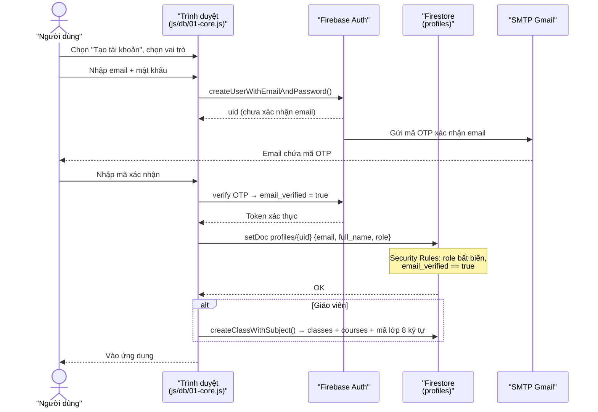

### 9.2. Học sinh vào lớp bằng mã lớp

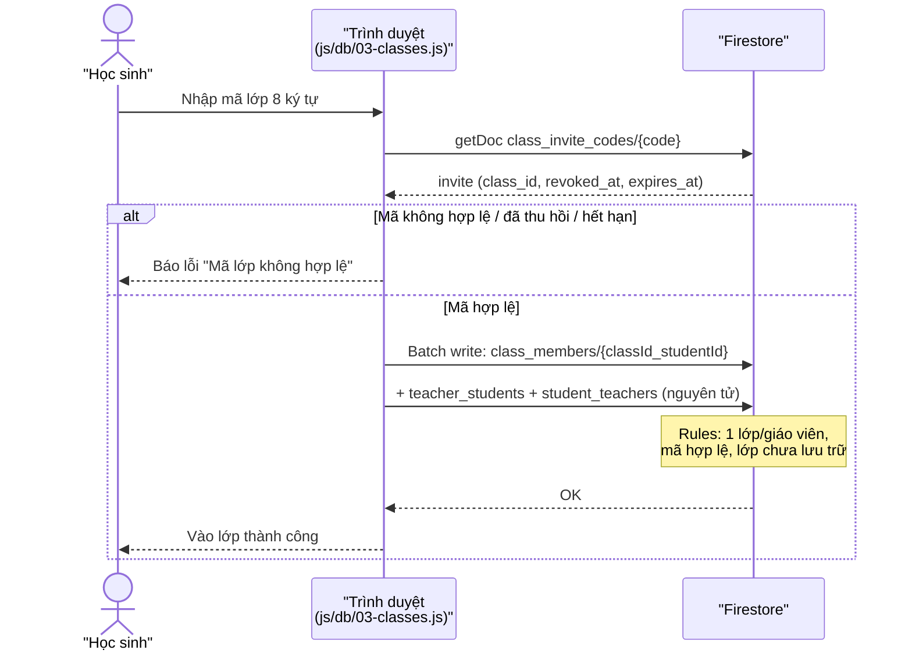

### 9.3. Giáo viên tạo lớp và cấp mã lớp

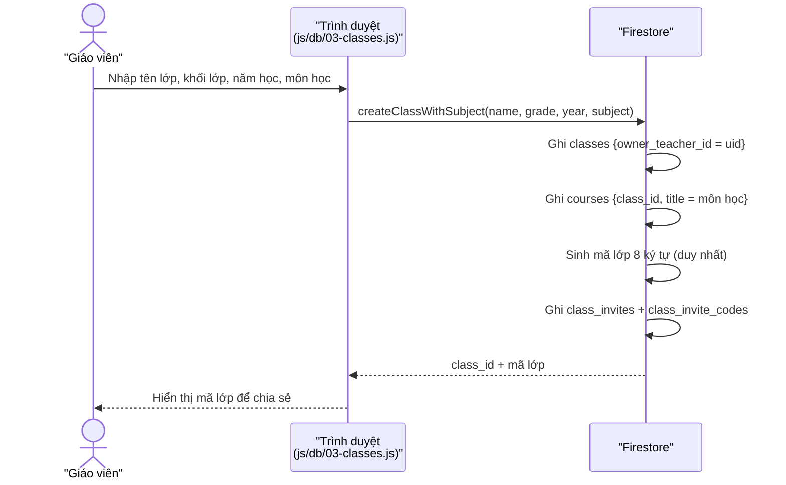

### 9.4. Học sinh nộp bài tập

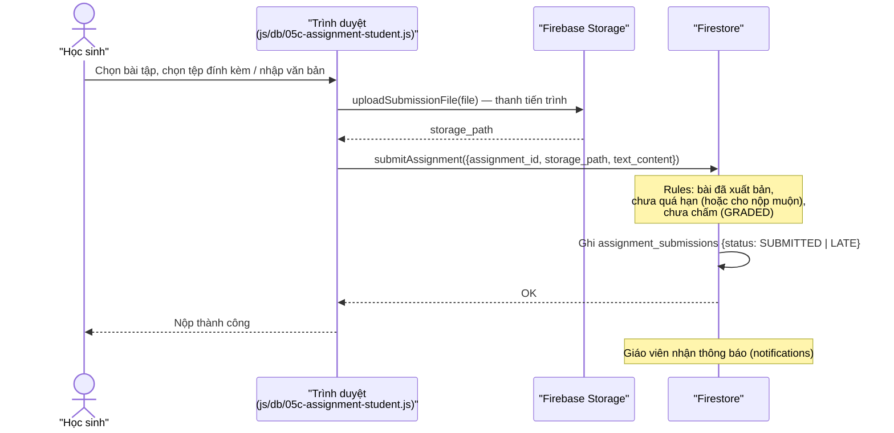

### 9.5. Giáo viên chấm bài tập theo rubric

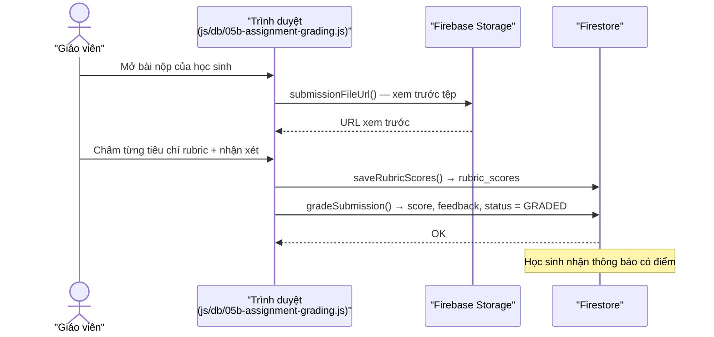

### 9.6. Học sinh làm bài kiểm tra tính giờ

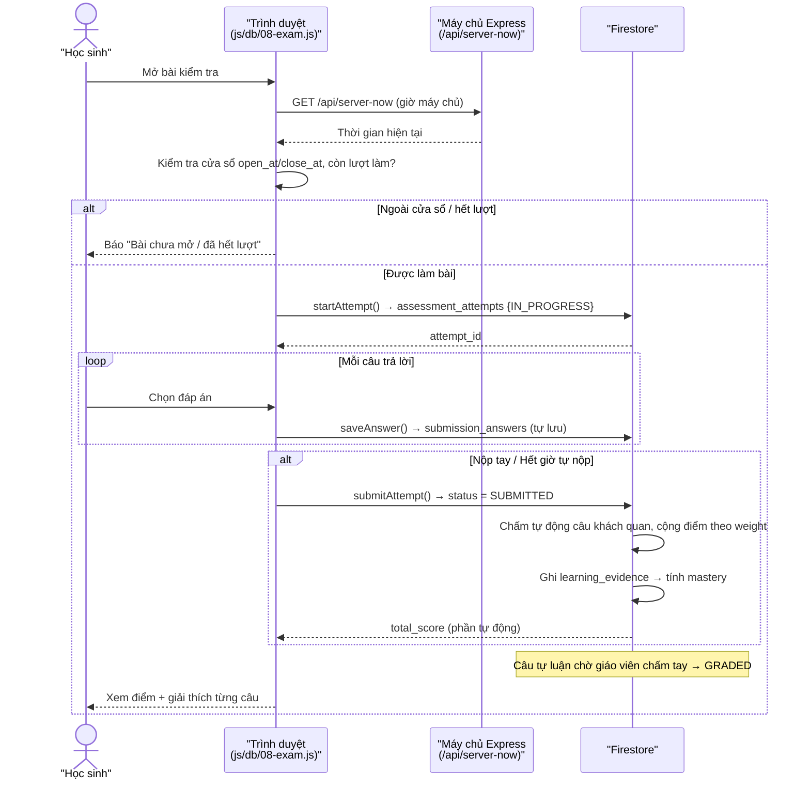

### 9.7. Giáo viên ra bài kiểm tra

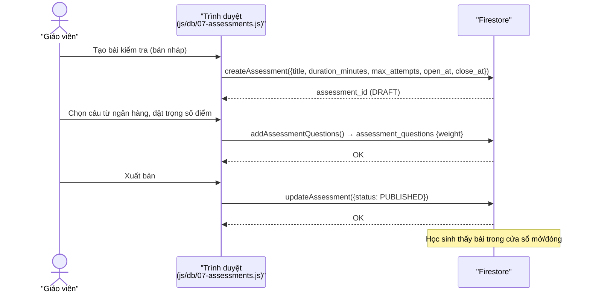

### 9.8. Luyện tập thích ứng (Adaptive Practice)

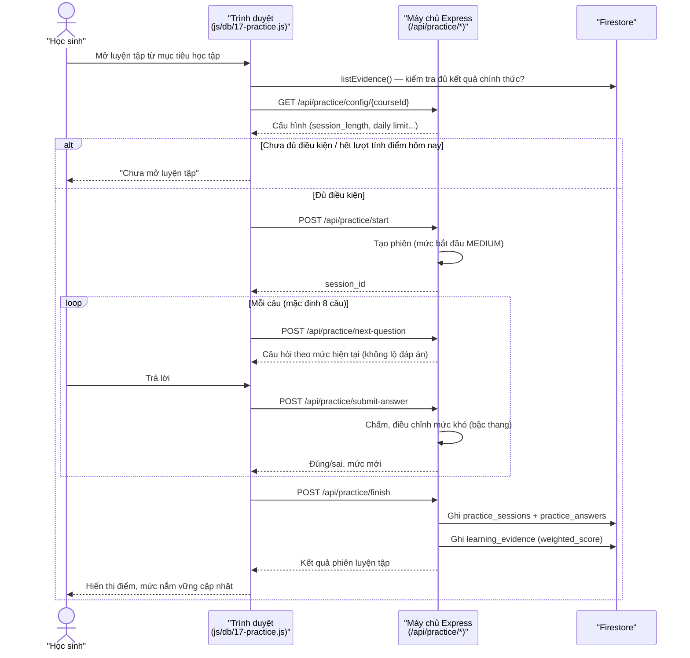

### 9.9. AI tạo câu hỏi nháp

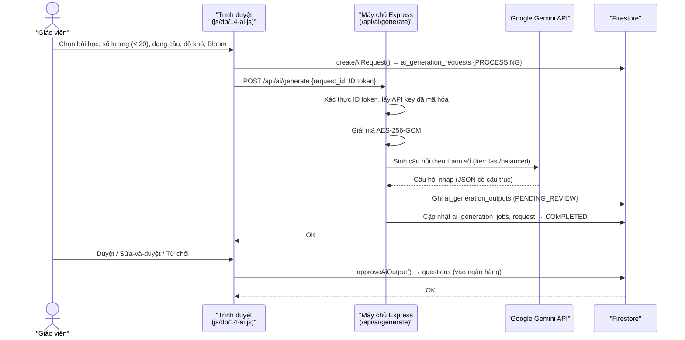

### 9.10. Trợ lý AI trò chuyện

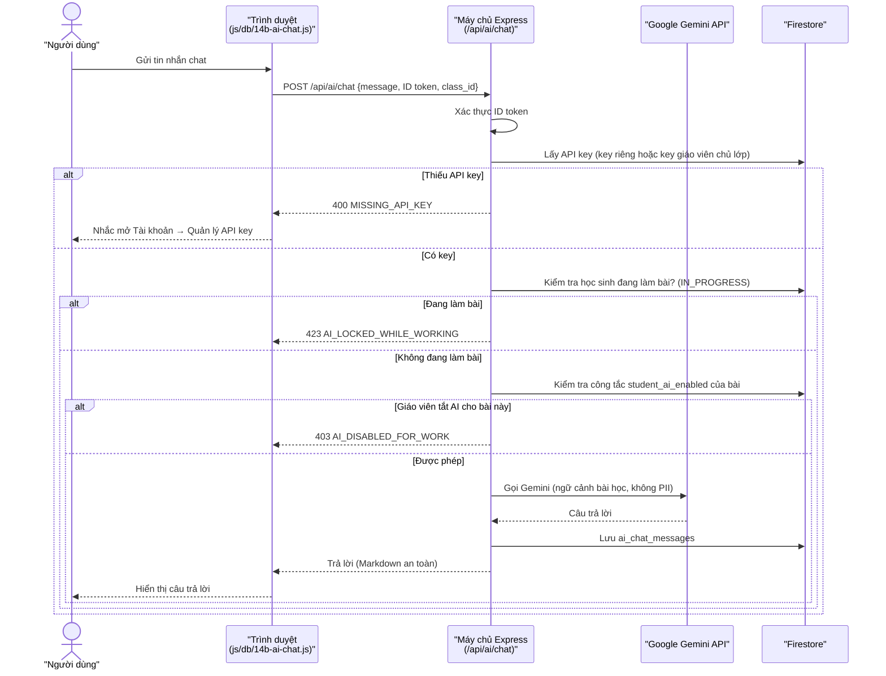

### 9.11. Lưu và kiểm tra API key Gemini (BYO key)

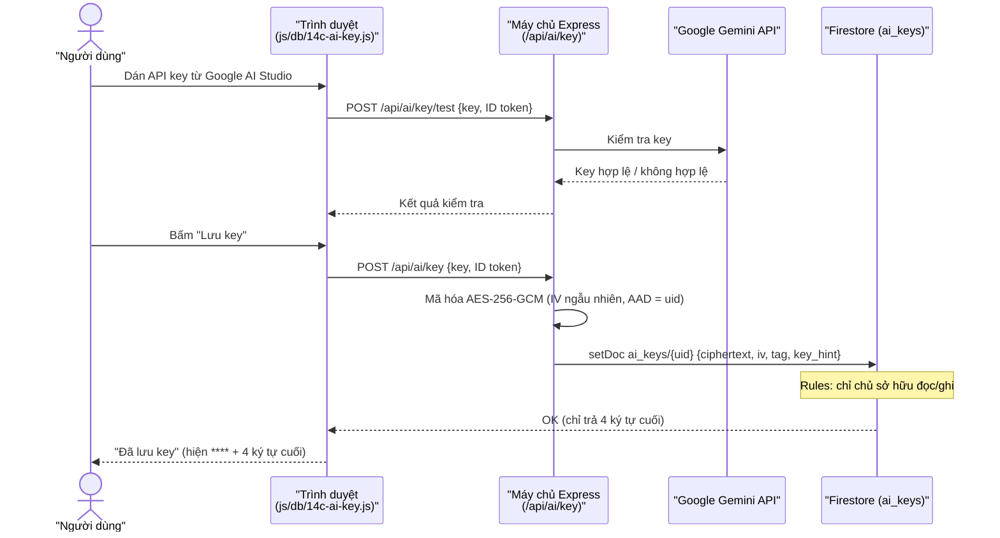

### 9.12. Thông báo Realtime

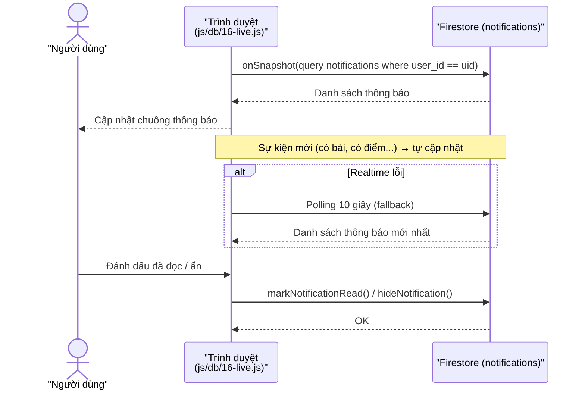

---

## 10. QUY ĐỊNH NGHIỆP VỤ

### 10.1. Quy định về tài khoản và vai trò

| # | Quy định |
|---|---|
| N1 | Hệ thống chỉ dùng tài khoản thật đăng ký bằng email; **bắt buộc xác nhận email bằng mã OTP** trước khi sử dụng. |
| N2 | Vai trò (`TEACHER`/`STUDENT`) chọn lúc đăng ký và **không thay đổi được** sau khi tạo. |
| N3 | `role`, `id`, `email`, `createdAt` trong `profiles` là **bất biến** sau khi tạo; chỉ được sửa `full_name`. |
| N4 | Giáo viên phải hoàn tất **tên lớp + môn học** trước khi dùng chức năng dạy học. |
| N5 | Giáo viên có thể tự tạo tài khoản cho học sinh (tự đặt mật khẩu). |
| N6 | Khối lớp hợp lệ: **3–12** (`EDUCMIND_GRADE_MIN/MAX` trong `js/00-grade-config.js`); đổi dải cần tạo migration/quy tắc mới, không sửa quy tắc đã triển khai. |

### 10.2. Quy định về lớp học

| # | Quy định |
|---|---|
| L1 | Chỉ giáo viên đã xác nhận email mới được tạo lớp; `owner_teacher_id` phải bằng chính người tạo và không đổi. |
| L2 | Mỗi lớp có **mã lớp 8 ký tự** do hệ thống sinh (duy nhất, không trùng). |
| L3 | Học sinh chỉ thuộc **một lớp cho mỗi giáo viên (mỗi môn học)**; không tự chuyển lớp — giáo viên thêm/gỡ/chuyển. |
| L4 | Vào lớp bằng mã phải thỏa: mã tồn tại, chưa thu hồi (`revoked_at`), chưa hết hạn (`expires_at`), lớp chưa lưu trữ. |
| L5 | Giáo viên dạy nhiều lớp mới có ô chọn lớp để chuyển; học sinh chỉ thấy tên lớp (không có ô chọn). |
| L6 | Lớp có thể lưu trữ (archive) và khôi phục. |

### 10.3. Quy định về nội dung

| # | Quy định |
|---|---|
| C1 | Cấu trúc nội dung: **Khóa học → Chủ đề → Bài học → Mục tiêu**; tài liệu gắn với bài học. |
| C2 | Trạng thái xuất bản: `DRAFT` (chỉ giáo viên thấy) / `PUBLISHED` (học sinh thấy). |
| C3 | Tệp tài nguyên: mọi định dạng (doc, docx, xlsx, pptx, PDF, ảnh, video, âm thanh, tệp code `.h/.cpp/.py/…`), **tối đa 50 MB**. |
| C4 | Tên tệp có dấu/khoảng trắng vẫn tải lên được; tên lưu kho chuẩn hóa bỏ dấu, tên gốc giữ nguyên khi hiển thị/tải xuống. |
| C5 | Xóa nội dung là **xóa mềm** (Thùng rác), khôi phục được; xóa vĩnh viễn chỉ khi dọn Thùng rác. |
| C6 | Mọi chỉnh sửa nội dung được ghi nhật ký (`content_revisions`). |

### 10.4. Quy định về câu hỏi

| # | Quy định |
|---|---|
| Q1 | 7 dạng câu hỏi: một lựa chọn, nhiều lựa chọn, đúng/sai, điền khuyết, ghép đôi, trả lời ngắn, tự luận. |
| Q2 | Câu một lựa chọn có **đúng một đáp án đúng**; câu nhiều lựa chọn có ít nhất một đáp án đúng. |
| Q3 | Mỗi câu hỏi có độ khó (Dễ/Vừa sức/Khó), cấp Bloom (6 mức, tùy chọn), khối lớp, giải thích đáp án. |
| Q4 | Câu hỏi gắn mục tiêu học tập qua `question_objectives`. |
| Q5 | Câu hỏi AI sinh ra ở trạng thái **chờ duyệt**; chỉ vào ngân hàng sau khi giáo viên duyệt/sửa-và-duyệt. |
| Q6 | Câu hỏi trò chơi không được lộ câu đang dùng cho bài kiểm tra chưa đóng. |

### 10.5. Quy định về bài tập

| # | Quy định |
|---|---|
| B1 | Bài tập tạo trước ở bản nháp; câu hỏi tạo/nhập từ trang chi tiết bài tập được gắn trực tiếp vào bài. |
| B2 | Hạn nộp `due_at`; nếu cho nộp muộn thì có `late_close_at > due_at`. |
| B3 | Bài nộp có trạng thái `SUBMITTED` (đúng hạn) / `LATE` (muộn) / `GRADED` (đã chấm). |
| B4 | Học sinh được nộp lại theo số lượt; bài đã chấm không sửa được. |
| B5 | Giáo viên chấm theo rubric nhiều tiêu chí hoặc chấm tổng + nhận xét; xem trước tệp bài nộp khi chấm. |
| B6 | Giáo viên có thể cấp thêm lượt làm bù cho từng học sinh. |
| B7 | Học sinh không tự chấm bài (Security Rules chặn sửa `score`/`status` GRADED). |

### 10.6. Quy định về bài kiểm tra

| # | Quy định |
|---|---|
| K1 | Bài kiểm tra có cửa sổ mở/đóng (`open_at`/`close_at`, `close_at > open_at`) và thời gian làm (`duration_minutes`). |
| K2 | Hạn nộp và đồng hồ làm bài tính theo **giờ máy chủ**, không phụ thuộc đồng hồ máy người dùng. |
| K3 | Số lượt làm = `max_attempts` + lượt bù; chỉ một lượt `IN_PROGRESS` tại một thời điểm. |
| K4 | Điểm từng câu theo trọng số (`weight`), hệ thống tự cộng tổng — giáo viên không nhập tổng. |
| K5 | Câu khách quan chấm tự động; câu tự luận/trả lời ngắn chấm tay. |
| K6 | Lượt làm đã chấm (`GRADED`) bị khóa: học sinh không sửa được điểm/trạng thái; chỉ giáo viên chấm lại. |
| K7 | F5/mất mạng không mất bài: lượt làm dở được khôi phục (auto-resume), tự lưu liên tục. |
| K8 | Hết giờ tự nộp. |

### 10.7. Quy định về luyện tập, trò chơi và phân tích

| # | Quy định |
|---|---|
| P1 | Luyện tập thích ứng mở khi học sinh có đủ kết quả chính thức (`practice_unlock_min_official`, mặc định 1). |
| P2 | Giới hạn số phiên tính điểm mỗi ngày (`practice_daily_scored_sessions`, mặc định 3); điểm luyện tập chiếm tối đa `practice_max_share` (0.5) trong mức nắm vững. |
| P3 | Trò chơi không ảnh hưởng điểm chính thức; kết quả chơi chỉ để ôn tập và thống kê. |
| P4 | Mức nắm vững tính từ bằng chứng học tập (bài tập, bài kiểm tra, luyện tập); phân loại: Cần ôn (< 0.4), Đang tiến bộ (0.4–0.7), Vững (≥ 0.7). |
| P5 | Lỗ hổng kiến thức có trạng thái OPEN/RESOLVED/DISMISSED; đã đóng không sửa được bởi người không có quyền. |
| P6 | Gợi ý học tập: học sinh chỉ được chấp nhận/bỏ qua (không sửa nội dung gợi ý). |

### 10.8. Quy định về AI

| # | Quy định |
|---|---|
| A1 | Mô hình **BYO key**: mỗi người dùng tự đăng ký API key Gemini; không có key thì Trợ lý AI không chạy (400 `MISSING_API_KEY`). |
| A2 | API key lưu **mã hóa AES-256-GCM** ở máy chủ; key thô không bao giờ trả lại trình duyệt (chỉ hiện 4 ký tự cuối). |
| A3 | Học sinh không có key riêng thì dùng key của **giáo viên chủ lớp**; học sinh cũng có thể tự lưu key riêng. |
| A4 | Mỗi bài tập/bài kiểm tra có công tắc `student_ai_enabled` (mặc định **bật**); giáo viên tắt trong lúc tạo/sửa bài. |
| A5 | Trong lúc học sinh **đang làm bài**, Trợ lý AI bị khóa hoàn toàn tới khi nộp (423 `AI_LOCKED_WHILE_WORKING`) — tải lại trang, mở tab mới hay dùng khung chat nổi đều không mở khóa được. |
| A6 | Giáo viên tắt công tắc của một bài → học sinh hỏi AI trong ngữ cảnh bài đó bị từ chối (403 `AI_DISABLED_FOR_WORK`). |
| A7 | Chỉ tên lớp/chủ đề/bài học/mục tiêu được gửi cho Gemini; **dữ liệu cá nhân học sinh không được gửi**. |
| A8 | AI tạo tối đa **20 câu/lượt**; câu hỏi AI chờ giáo viên duyệt trước khi vào ngân hàng. |
| A9 | Không đổi `AI_KEY_ENCRYPTION_KEY` sau khi người dùng đã lưu key (key đã lưu sẽ không giải mã được). |

### 10.9. Quy định về thông báo và dữ liệu

| # | Quy định |
|---|---|
| T1 | Thông báo gửi tới từng người dùng; người dùng đánh dấu đã đọc/ẩn (xóa mềm). |
| T2 | Các bảng phân tích (`mastery`, `learning_evidence`, `knowledge_gaps`, `content_revisions`, `notifications`) do hệ thống ghi — người dùng chỉ được đọc. |
| T3 | Mọi thao tác nhiều bước (tạo lớp, vào lớp, bắt đầu/nộp bài, tạo tài khoản học sinh, sinh câu hỏi AI) thực hiện nguyên tử (batch/transaction). |
| T4 | Trường thời gian (`createdAt`, `updatedAt`) do máy chủ ghi; `createdAt` bất biến, `updatedAt` cập nhật mỗi lần sửa. |
| T5 | Mọi chuỗi có giới hạn độ dài, mọi mảng có giới hạn số phần tử (chống payload quá lớn). |

---

## 11. BẢO MẬT HỆ THỐNG

### 11.1. Phân quyền ở tầng cơ sở dữ liệu (Firestore Security Rules)

`firestore.rules` (~102 KB, 47 collections) thực hiện nguyên tắc **"payload-first"**: mọi yêu cầu ghi đều được kiểm tra cấu trúc dữ liệu, quyền sở hữu và trạng thái trước khi cho phép.

**Các bất biến dữ liệu (Data Invariants):**

1. **Danh tính & vai trò (`profiles`)**: `id == uid`; tạo mới yêu cầu `email_verified == true` và `role ∈ {STUDENT, TEACHER}`; `role`, `id`, `email`, `createdAt` bất biến; chỉ sửa được `full_name`. Cấm đọc danh sách hồ sơ (chống lộ email PII) — chỉ chủ sở hữu hoặc người cùng lớp mới đọc được hồ sơ của nhau.
2. **Lớp học & thành viên**: chỉ giáo viên đã xác nhận email mới tạo lớp; `owner_teacher_id == uid` và bất biến. Học sinh vào lớp chỉ bằng mã mời hợp lệ hoặc do giáo viên chủ lớp thêm, kèm ghi nguyên tử 2 liên kết roster. Mỗi học sinh tối đa 1 lớp/giáo viên.
3. **Nội dung & đánh giá**: mọi tài liệu mang `teacher_id` + `class_id`; chỉ giáo viên chủ lớp được tạo/sửa/xóa. Học sinh đọc nội dung đã xuất bản qua chỉ mục lớp.
4. **Bài nộp & lượt làm**: học sinh chỉ sửa bài của mình khi còn trong lớp; lượt làm đã chấm (`GRADED`) bị khóa; học sinh không tự chấm bài; lỗ hổng đã đóng không sửa được.
5. **AI & thông báo**: hội thoại AI riêng tư từng người; yêu cầu/output AI và nhật ký sửa nội dung chỉ chủ sở hữu; trường thời gian phải bằng `request.time` (chống giả mạo thời gian).

### 11.2. Chống tấn công — "Dirty Dozen" (12 payload độc hại)

Hệ thống kiểm thử 12 trường hợp tấn công phải bị từ chối (`PERMISSION_DENIED`):

| # | Tấn công | Kết quả mong đợi |
|---|---|---|
| 1 | Học sinh tự nâng vai trò STUDENT → TEACHER | Bị chặn (chỉ sửa được `full_name`) |
| 2 | Chèn trường lạ `isAdmin: true` khi tạo hồ sơ | Bị chặn (chỉ cho phép trường khai báo) |
| 3 | Email chưa xác nhận mà tạo lớp | Bị chặn (`email_verified == true`) |
| 4 | Tạo lớp giả danh `owner_teacher_id` của người khác | Bị chặn (`owner_teacher_id == uid`) |
| 5 | Tự ghi thành viên lớp không có mã mời hợp lệ | Bị chặn (thiếu liên kết roster nguyên tử) |
| 6 | Học sinh tự chấm bài cho mình (điểm 10) | Bị chặn (không sửa được điểm/trạng thái) |
| 7 | Mở lại lượt làm đã chấm để sửa điểm | Bị chặn (trạng thái GRADED khóa) |
| 8 | Đọc hồ sơ/email của người không cùng lớp | Bị chặn (cô lập PII) |
| 9 | ID tài liệu chứa ký tự độc hại (`bad$id/...`) | Bị chặn (regex ID + giới hạn 128 byte) |
| 10 | Chuỗi quá lớn (nội dung 10.000 ký tự) | Bị chặn (giới hạn `.size()`) |
| 11 | Giả mạo thời gian tạo (2020) thay vì giờ máy chủ | Bị chặn (`createdAt == request.time`) |
| 12 | Quét danh sách toàn bộ hồ sơ/câu hỏi | Bị chặn (cấm `allow list` không điều kiện) |

### 11.3. Bảo mật phía máy chủ và trình duyệt

| Hạng mục | Biện pháp |
|---|---|
| **Xác thực API** | Mọi lời gọi `/api/*` gửi Firebase ID token (header `Authorization`, header `X-EducMind-Token`, và trường `auth_token` trong thân JSON cho request có thân). Request GET/HEAD không bao giờ có thân. Lấy token từ thân thì kiểm tra `Origin`/`Referer` (cùng host hoặc trong `ALLOWED_ORIGINS`) để trang khác không gọi hộ. Token bị xóa khỏi body trước khi xử lý, không ghi vào Firestore hay gửi cho Gemini. |
| **Mã hóa API key** | AES-256-GCM, khóa = `sha256(AI_KEY_ENCRYPTION_KEY)`, IV 12 byte ngẫu nhiên, AAD = uid. Chỉ chủ sở hữu đọc/ghi `ai_keys/{uid}`. |
| **Vai trò** | Luôn lấy từ `profiles/{uid}.role` trên Firestore, không tin tham số trình duyệt gửi. |
| **Chống XSS** | Escape HTML khi render; bộ kiểm thử DOM/XSS (1878 dòng) kiểm tra không có inline event handler, Markdown AI được escape HTML. |
| **HTTP Headers** | CSP chặt (`script-src 'self'` + Google domains), `X-Content-Type-Options: nosniff`, `Referrer-Policy`, `Permissions-Policy` (tắt camera/micro/geolocation…), `frame-ancestors` giới hạn. |
| **Hạ tầng AI** | Mọi lời gọi ra Google có timeout 15 giây + thử lại 1 lần; lỗi mạng báo 502 `UPSTREAM_UNREACHABLE` kèm câu tiếng Việt thay vì `fetch failed` thô. Trang chẩn đoán `GET /api/health/upstream`. |
| **Email** | Gmail chỉ thay máy chủ gửi thư (SMTP); Supabase/Firebase Auth vẫn tạo tài khoản, phát hành/kiểm tra OTP, lưu mật khẩu. Không gửi mật khẩu qua Gmail, không tắt xác nhận email. App Password không lưu trong mã nguồn. |

---

## 12. KIỂM THỬ HỆ THỐNG

### 12.1. Chiến lược kiểm thử

| Loại kiểm thử | Công cụ | Phạm vi |
|---|---|---|
| **Unit test tự động** | Node.js Test Runner (`node:test`) | Logic nghiệp vụ: cấu hình khối lớp, tiện ích, đọc CSV, phân tích nhập câu hỏi, chấm điểm trò chơi, bảo mật AI key, DOM/XSS |
| **Kiểm thử Security Rules** | `firestore.rules.test.ts` (Firebase Rules Unit Testing) | 12 payload tấn công "Dirty Dozen" phải bị từ chối |
| **Kiểm thử trên trình duyệt** | `tests/grade-config.test.html` | Cấu hình khối lớp trực tiếp trên trình duyệt, không cần backend |
| **Kiểm tra cú pháp** | `node --check` (`npm run lint`) | Toàn bộ mã JavaScript |
| **Kiểm thử thủ công** | Theo checklist §12.3 | Luồng nghiệp vụ end-to-end trên trình duyệt |

### 12.2. Kết quả kiểm thử tự động (đã chạy)

```
npm test  →  node --test tests/*.test.mjs

tests/educmind.test.mjs      12 tests  PASS
tests/ai-chat.test.mjs        6 tests  PASS
tests/ai-key-vault.test.mjs   2 tests  PASS
tests/dom-xss.test.mjs       24 tests  PASS
─────────────────────────────────────────────
Tổng cộng:                   44 tests  PASS (0 fail)
```

**Chi tiết các nhóm test:**

| Tệp test | Nội dung kiểm thử |
|---|---|
| `educmind.test.mjs` (12) | Cấu hình khối lớp (3–12); escape HTML, guard URL/image, mức nắm vững; chuẩn hóa tiếng Việt + parser CSV; phân giải khối lớp + tên tệp an toàn; routing hash, chuẩn hóa vai trò, khôi phục phiên F5, bảo vệ hash auth; ngưỡng cấu hình khóa học được lưu và kẹp (clamp); guard auto-resume F5 + định dạng đồng hồ thi; helper bài tập/bài kiểm tra/lịch/tiến độ; kiểm tra câu hỏi + parser nhập hàng loạt cho cả 7 dạng; kiểm tra trò chơi + tự chấm 5 dạng mục tiêu; builder Excel/Word OOXML + bundle xlsx/mammoth; quy tắc ghi danh đa môn cùng khối lớp |
| `ai-chat.test.mjs` (6) | Định tuyến mô hình Gemini theo tier/mode/intent; formatter Markdown an toàn (escape HTML); quyền AI theo vai trò, phiên thi/bài tập, công tắc giáo viên từng bài; `apiRequest` gửi ID token ở header + body, thử lại 1 lần với token mới khi `AUTH_REQUIRED`; không gửi body với GET/HEAD; không crash khi proxy trả HTML/null |
| `ai-key-vault.test.mjs` (2) | Lưu/trạng thái API key qua vòng mã hóa (chỉ ciphertext); lỗi mạng upstream báo 502 `UPSTREAM_UNREACHABLE` |
| `dom-xss.test.mjs` (24) | Audit tĩnh HTML/JS (lazy vendor, không inline handler); render DOM & miễn nhiễm XSS ở auth/giáo viên/học sinh; event ủy thác không cần inline attribute; cache nháp offline, banner mất mạng, khôi phục F5, đồng bộ lại, dọn dẹp khi đăng xuất; lazy-loader dedupe; DOM/XSS cho trò chơi (5 dạng câu), AI tạo câu hỏi, báo cáo tiến bộ; shell Botanical Teal, thẻ người dùng, tìm kiếm toàn cục, dock dưới, bảng công việc, đổi theme; quy tắc lớp (1 lớp/giáo viên, học sinh không chuyển lớp, giáo viên được chuyển); luyện tập thích ứng có dock nổi + thống kê; mọi trang trừ màn hình thi đều có dock nổi; logo EducMind gradient chung; Trợ lý AI đúng một lối vào; bố cục báo cáo; nhãn tiếng Việt (không còn nhãn tiếng Anh viết tắt) |
| `firestore.rules.test.ts` | 12 payload "Dirty Dozen" đều bị `PERMISSION_DENIED` (chạy bằng Firebase Emulator) |
| `grade-config.test.html` | Kiểm thử cấu hình khối lớp trên trình duyệt (xem số đạt/lỗi trực tiếp) |

### 12.3. Checklist kiểm thử chức năng (thủ công)

| # | Chức năng | Trường hợp kiểm thử | Kết quả mong đợi |
|---|---|---|---|
| 1 | Đăng ký giáo viên | Đăng ký → xác nhận OTP → nhập tên lớp/môn | Tạo lớp + khóa học + mã lớp 8 ký tự |
| 2 | Đăng ký học sinh | Đăng ký → xác nhận OTP → nhập mã lớp | Vào đúng lớp của giáo viên |
| 3 | Vào lớp sai mã | Nhập mã không tồn tại/hết hạn/đã thu hồi | Báo lỗi, không vào được lớp |
| 4 | Một lớp/giáo viên | Học sinh đã có lớp của GV A, nhập mã lớp của GV A khác | Bị chặn; chỉ giáo viên chuyển được |
| 5 | Soạn nội dung | Tạo chủ đề → bài học → mục tiêu → tải tệp 50 MB | Lưu thành công, xem trước được |
| 6 | Tệp quá 50 MB | Tải tệp > 50 MB | Bị chặn |
| 7 | Xuất bản | Đưa bài học về nháp/xuất bản | Học sinh chỉ thấy bản đã xuất bản |
| 8 | Ngân hàng câu hỏi | Tạo đủ 7 dạng; câu 1 lựa chọn sai số đáp án đúng | Báo lỗi khi đáp án đúng ≠ 1 |
| 9 | Nhập câu hỏi Excel | Nhập tệp có dòng sai | Báo lỗi theo dòng, chỉ nhập dòng hợp lệ |
| 10 | Bài tập | Ra bài + rubric → học sinh nộp tệp/văn bản → giáo viên chấm theo tiêu chí | Điểm + nhận xét hiển thị cho học sinh |
| 11 | Nộp muộn | Nộp sau `due_at` khi cho phép/không cho phép | Trạng thái LATE / bị chặn |
| 12 | Bài kiểm tra | Học sinh làm bài, F5 giữa chừng | Khôi phục lượt làm dở, không mất bài |
| 13 | Hết giờ thi | Để đồng hồ chạy hết | Tự nộp, chấm tự động câu khách quan |
| 14 | Lượt làm | Làm hết `max_attempts`, giáo viên cấp lượt bù | Làm thêm được đúng số lượt bù |
| 15 | Tự chấm bài | Học sinh sửa điểm của mình (qua API) | Bị chặn bởi Security Rules |
| 16 | Luyện tập thích ứng | Chưa có kết quả chính thức → mở luyện tập | Bị chặn (chưa đủ điều kiện) |
| 17 | Trò chơi | Chơi đủ 3 chế độ | Ghi lịch sử chơi, không ảnh hưởng điểm |
| 18 | AI tạo câu hỏi | Tạo 20 câu → duyệt/sửa-và-duyệt/từ chối | Câu đã duyệt vào ngân hàng |
| 19 | Trợ lý AI | Học sinh đang làm bài → hỏi AI | Bị khóa (423) tới khi nộp |
| 20 | Trợ lý AI | Giáo viên tắt AI cho bài → học sinh hỏi AI trong ngữ cảnh bài | Bị từ chối (403) |
| 21 | API key | Lưu key → kiểm tra key → dùng AI | Chỉ hiện 4 ký tự cuối; AI chạy |
| 22 | Báo cáo | Xuất Excel/Word/in báo cáo | Tệp đúng định dạng, có sheet Bảng điểm |
| 23 | Thùng rác | Xóa nội dung → khôi phục → xóa vĩnh viễn | Khôi phục được; xóa vĩnh viễn không khôi phục được |
| 24 | Thông báo | Có bài mới/điểm mới | Chuông tự cập nhật (Realtime hoặc polling 10s) |
| 25 | Offline | Mất mạng khi làm bài → có mạng lại | Bài không mất, đồng bộ lại |
| 26 | Phân quyền | Người dùng A đọc dữ liệu lớp của người dùng B | Bị chặn (PERMISSION_DENIED) |

---

## 13. TRIỂN KHAI VÀ VẬN HÀNH

### 13.1. Các bước triển khai

1. **Tạo dự án Firebase** (miễn phí là đủ): bật Authentication (email/password + xác nhận email), Firestore, Storage.
2. **Áp dụng `firestore.rules`** vào Firestore (quy tắc bảo mật).
3. **Cấu hình email (SMTP Gmail)**: bật xác minh 2 bước cho Gmail → tạo App Password → cấu hình SMTP trong Firebase Auth (host `smtp.gmail.com`, port 587) → đặt template email xác nhận/đặt lại mật khẩu với biến `{{ .Token }}`.
4. **Cấu hình máy chủ**: tạo `.env` với `AI_KEY_ENCRYPTION_KEY` (≥ 32 ký tự, `openssl rand -base64 32`), tùy chọn `GEMINI_API_KEY`, `GEMINI_MODEL`, `PORT`.
5. **Chạy máy chủ**: `npm start` (cổng 3000) — máy chủ vừa phục vụ web tĩnh vừa cung cấp API AI.
6. **Cấu hình Auth URL**: đặt `site_url` và danh sách URL cho phép trong Firebase Auth theo địa chỉ website triển khai.

### 13.2. Vận hành

| Hạng mục | Lưu ý |
|---|---|
| **Biến môi trường** | Không commit `.env`; không đổi `AI_KEY_ENCRYPTION_KEY` sau khi người dùng đã lưu key |
| **Hạn mức email** | Gmail có hạn mức gửi thư; lượng lớn nên dùng dịch vụ SMTP chuyên dụng |
| **Hạn mức Gemini** | Google áp hạn mức theo dự án gắn với từng key (nhiều key cùng dự án vẫn dùng chung quota) |
| **Chẩn đoán lỗi AI** | Mở `GET /api/health/upstream` để kiểm tra máy chủ có gọi được Google không; lỗi mạng báo 502 `UPSTREAM_UNREACHABLE` |
| **Sao lưu** | Firestore tự sao lưu theo chính sách của Firebase; xuất dữ liệu qua tính năng báo cáo/nhập-xuất |
| **Giám sát** | Theo dõi log máy chủ (lỗi Firestore, upstream), số lượng thông báo, phiên luyện tập |

---

## 14. HẠN CHẾ VÀ HƯỚNG PHÁT TRIỂN

### 14.1. Hạn chế hiện tại

1. **Mô hình một trường**: hệ thống thiết kế cho một giáo viên nhiều lớp; chưa có quản trị viên trường (admin) quản lý toàn trường.
2. **Không có ứng dụng di động native**: chỉ có web responsive.
3. **Chấm tự động giới hạn**: câu trả lời ngắn/tự luận vẫn cần giáo viên chấm tay (AI chỉ hỗ trợ tham khảo đáp án mẫu).
4. **Phụ thuộc hạ tầng đám mây**: cần Internet; máy chủ AI cần ra được Internet để gọi Gemini.
5. **Thư mục `supabase/` còn di sản**: thiết kế PostgreSQL cũ chưa được dọn khỏi repository.
6. **Chưa có kiểm thử tải (load test)**: chưa đánh giá hiệu năng khi nhiều học sinh làm bài đồng thời.

### 14.2. Hướng phát triển

| Hướng | Nội dung |
|---|---|
| **Quản trị trường** | Thêm vai trò Admin: quản lý giáo viên, lớp, năm học toàn trường |
| **Ứng dụng di động** | Đóng gói PWA hoặc app native (React Native/Flutter) |
| **Chấm AI** | Dùng Gemini chấm câu trả lời ngắn/tự luận theo đáp án mẫu + rubric, giáo viên duyệt lại |
| **Học thích ứng nâng cao** | Gợi ý lộ trình học cá nhân hóa theo lịch sử luyện tập; phát hiện gian lận khi làm bài |
| **Tích hợp** | Đồng bộ điểm với hệ thống quản lý trường (SIS), đăng nhập SSO (Google/Microsoft), thanh toán học phí |
| **Đa ngôn ngữ** | i18n cho giao diện (hiện tại tiếng Việt) |
| **Phân tích nâng cao** | Dashboard dự đoán học sinh có nguy cơ rớt môn; báo cáo theo chuẩn Bộ GD&ĐT |
| **Kiểm thử hiệu năng** | Load test đồng thời; tối ưu truy vấn Firestore (chỉ mục, phân trang) |

---

## 15. PHỤ LỤC

### 15.1. Danh sách API máy chủ (Express)

| Method | Đường dẫn | Mô tả |
|---|---|---|
| GET | `/api/health/upstream` | Chẩn đoán kết nối tới Google (Firebase Auth, Firestore) |
| GET | `/api/server-now` | Giờ máy chủ (tính hạn nộp, đồng hồ thi) |
| POST | `/api/ai/generate` | AI tạo câu hỏi nháp bằng Gemini |
| GET/POST | `/api/ai/key`, `/api/ai/key/status` | Trạng thái API key Gemini của người dùng |
| POST | `/api/ai/key` | Lưu API key (mã hóa AES-256-GCM) |
| DELETE | `/api/ai/key` | Xóa API key đã lưu |
| POST | `/api/ai/key/test` | Kiểm tra API key (kể cả key chưa lưu) |
| POST | `/api/ai/chat` | Trợ lý AI trò chuyện |
| GET | `/api/practice/config/:courseId` | Cấu hình luyện tập thích ứng của khóa học |
| POST | `/api/practice/start` | Bắt đầu phiên luyện tập |
| POST | `/api/practice/next-question` | Lấy câu hỏi tiếp theo theo mức độ khó |
| POST | `/api/practice/submit-answer` | Chấm câu trả lời, điều chỉnh mức khó |
| POST | `/api/practice/finish` | Kết thúc phiên, ghi bằng chứng học tập |
| GET | `/api/practice/history/:objectiveId` | Lịch sử luyện tập theo mục tiêu |

### 15.2. Danh sách hàm dữ liệu chính (EducMindDB — ~162 hàm)

| Nhóm | Hàm tiêu biểu |
|---|---|
| Xác thực | `authInfo`, `getProfile`, `renameMe` |
| Lớp học | `createClass`, `createClassWithSubject`, `updateClass`, `archiveClass`, `restoreClass`, `regenClassCode`, `joinClass`, `addStudentByEmail`, `createStudentAccount`, `removeMember`, `listMembers`, `listClasses`, `listArchivedClasses` |
| Nội dung | `createCourse`, `createTopic`, `createLesson`, `createObjective`, `createResource`, `updateTopic/Lesson/Objective`, `softDeleteTopic`, `restoreTopic/Lesson`, `listTopics/Lessons/Objectives/Resources` |
| Câu hỏi | `createQuestion`, `createQuestions`, `updateQuestion`, `restoreQuestion`, `listQuestions`, `addQuestionObjectives`, `removeQuestionObjectives` |
| Bài tập | `createAssignment`, `updateAssignment`, `restoreAssignment`, `listAssignments`, `addAssignmentQuestions`, `createRubricCriterion`, `saveRubricScores`, `submitAssignment`, `saveAssignmentAnswers`, `gradeAssignmentAnswer`, `gradeSubmission`, `deleteUngradedSubmission` |
| Bài kiểm tra | `createAssessment`, `updateAssessment`, `listAssessments`, `addAssessmentQuestions`, `startAttempt`, `saveAnswer`, `submitAttempt`, `finalizeExpiredAttempts`, `gradeAnswer`, `reviewAttempt`, `regradeAssessment`, `grantExtraAttempts`, `listAttempts`, `listExtraAttempts` |
| Phân tích | `listMastery`, `listMasterySnapshots`, `listEvidence`, `listGaps`, `dismissGap`, `listRecommendations`, `respondRecommendation`, `getObjectiveCoverage`, `getClassOverview`, `getStudentObjectiveSupport` |
| Luyện tập | `practiceStart`, `practiceNextQuestion`, `practiceSubmitAnswer`, `practiceFinish`, `listPracticeSessions`, `listPracticeAnswers`, `getCoursePracticeConfig` |
| Trò chơi | `gameQuestions`, `createGameSession`, `listGameSessions` |
| AI | `aiGenerate`, `createAiRequest`, `listAiRequests`, `listAiOutputs`, `approveAiOutput`, `updateAiOutput`, `listAiJobs`, `aiKeySave`, `aiKeyStatus`, `aiKeyTest`, `aiKeyDelete`, `sendAiChat`, `createChatThread`, `listChatThreads`, `listChatMessages`, `saveChatQuestionsToDrafts` |
| Thông báo | `listNotifications`, `markNotificationRead`, `markAllNotificationsRead`, `hideNotification`, `hideAllNotifications` |
| Thùng rác | `trashItemDependencies`, `purgeTrashedItem`, `listDeletedTopics/Lessons/Assignments/Assessments/Questions` |
| Tệp | `uploadResourceFile`, `uploadSubmissionFile`, `resourceFileUrl`, `submissionFileUrl`, `removeResourceFile`, `removeSubmissionFile` |
| Khác | `serverNow`, `listRevisions`, `listProfiles`, `listInvites`, `listCourses`, `listCoursesForClasses` |

### 15.3. Cấu hình luyện tập thích ứng (mặc định)

| Tham số | Giá trị | Ý nghĩa |
|---|---|---|
| `practice_weight` | 0.3 | Trọng số điểm luyện tập trong mức nắm vững |
| `practice_unlock_min_official` | 1 | Số kết quả chính thức tối thiểu để mở luyện tập |
| `practice_session_length` | 8 | Số câu mỗi phiên luyện tập |
| `practice_daily_scored_sessions` | 3 | Số phiên tính điểm tối đa mỗi ngày |
| `practice_max_share` | 0.5 | Tỉ lệ tối đa điểm luyện tập trong mức nắm vững |
| `dash_reteach_share` | 0.4 | Ngưỡng gợi ý dạy lại (dashboard giáo viên) |
| `dash_min_students` | 5 | Số học sinh tối thiểu để thống kê lớp |
| `dash_advanced_threshold` | 0.8 | Ngưỡng học sinh nâng cao |
| `dash_inactive_days` | 14 | Số ngày không hoạt động để cảnh báo |
| `dash_question_min_answers` | 10 | Số lượt trả lời tối thiểu cho thống kê câu hỏi |

### 15.4. Tài liệu tham khảo trong repository

| Tài liệu | Nội dung |
|---|---|
| `README.md` | Hướng dẫn chạy, cấu hình backend, tính năng (bản tóm tắt) |
| `security_spec.md` | Đặc tả bảo mật Firestore (bất biến dữ liệu + 12 payload tấn công) |
| `firestore.rules` | Quy tắc bảo mật Firestore đầy đủ (nguồn chuẩn phân quyền) |
| `firestore.rules.test.ts` | Kiểm thử 12 payload tấn công |
| `supabase/migrations/` | Thiết kế backend PostgreSQL trước đây (di sản) |
| `firebase-blueprint.json` | Bản thiết kế ứng dụng Firebase |

---

*Báo cáo được lập dựa trên phân tích mã nguồn tại thời điểm 27/11/2026 (nhánh `arena/198e0863-smartedu`, commit `bf150d5`).*
